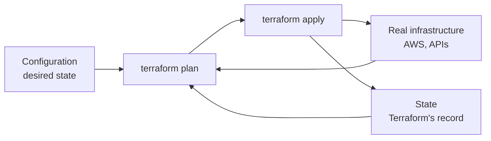

# Lab 1 — Why Terraform is declarative infrastructure as code

This is a reading note, not a runnable configuration. There is no `main.tf`, no provider, and no AWS account to touch. It answers the question behind the first lesson: why does Terraform call itself declarative, and what makes the declaration real? The short answer is a pair of artifacts that the rest of the course keeps returning to: the **state file** records what Terraform believes it owns, and the **plan** compares that belief with the configuration and the real infrastructure.

The note is deliberately small. Lab 0 exercises initialization; Lab 2 starts configuring providers. This page is the conceptual bridge between them.

## The problem with a list of steps

An imperative script says *how* to reach a result: create this VPC, then this subnet, then this route, then this instance. That works until the script runs twice. The second run either fails because the objects already exist, or creates duplicates, or needs a pile of "if it exists" checks. The script encodes the steps, not the destination.

A declarative configuration says *what* the result should be: a VPC with this CIDR, a public subnet, a route to an internet gateway, an instance in the subnet. Terraform reads the configuration, compares it with the state and the real infrastructure, and computes the steps needed to converge. You describe the destination; Terraform works out the path.

That does not mean Terraform ignores order. It builds a dependency graph from references: a subnet that reads `aws_vpc.main.id` depends on the VPC; a route that reads `aws_internet_gateway.igw.id` depends on the gateway. The graph gives Terraform the order without you writing a procedural sequence. The order is a consequence of the data flow, not a separate script.

## The three artifacts

| Artifact | Question it answers | Where it lives |
| --- | --- | --- |
| Configuration | What should exist? | The `.tf` files in the working directory |
| State | What does Terraform believe it owns? | `terraform.tfstate` or a remote backend |
| Plan | What would change to make reality match the configuration? | Computed by `terraform plan`, optionally saved to a file |

The plan is a diff with three inputs. The configuration says what you want; the state says what Terraform thinks it manages; the provider reads the real objects and reports their current attributes. If the three agree, the plan is empty. If they disagree, the plan proposes creates, updates, or destroys. `terraform apply` executes the plan and updates the state to match the result.

The state is not a cache and not a backup. It is the mapping between a resource address such as `aws_subnet.public` and a real object such as `subnet-0abc123`. Without that mapping, Terraform would not know whether a subnet in AWS is the one it created, an unrelated subnet with the same CIDR, or something that should be imported. That is why state is sensitive, why it belongs in a remote backend for team work, and why deleting it is a destructive operation rather than a cleanup.

## Idempotence and convergence

A declarative configuration is **idempotent** when applying it repeatedly reaches the same result. The first apply creates the objects; the second apply finds that the state and the real objects already match the configuration and proposes no changes. That is not because Terraform remembers the script's last line; it is because the comparison is repeated from scratch.

The same property lets Terraform **converge** after drift. If someone changes a tag in the AWS console, the next plan sees the difference between the configured tag and the real tag and proposes an update. If someone deletes an object, the next plan proposes to recreate it. The configuration is the source of truth; the state and the provider supply the current facts.

Idempotence has limits. A resource argument that is computed by AWS, such as an allocation ID or a generated password, may change outside Terraform's control. A provider may normalize a value differently from the configuration. A resource may be replaced because an argument is force-new. The plan is where those differences become visible; "idempotent" does not mean "the plan is always empty forever."

## What Terraform is not

- It is not a configuration-management tool in the Ansible sense. It focuses on provisioning and lifecycle of infrastructure objects through providers; installing packages inside an instance is usually a job for user data, cloud-init, or a separate tool.
- It is not imperative. You do not write the order of API calls; you write references and let the graph decide.
- It is not a secret store. State can contain sensitive attributes, even when an output is marked `sensitive`. `sensitive` redacts CLI output; it does not encrypt state.
- It is not a backup system. `prevent_destroy` can guard a resource, but it is not a backup, and it does not protect against manual deletion outside Terraform.

## A concrete mental model

Imagine three public subnets in one VPC. The imperative version is a sequence: create the VPC, create subnet A, create subnet B, create subnet C, associate each one. The declarative version is a set of objects with references: each subnet points at the VPC, and a `for_each` or `count` describes the set. Terraform reads the references, builds the graph, and plans the creates in the order the graph allows. On the second run, it compares the same objects with the state and the real subnets; if nothing changed, the plan is empty.

The mental model is a **control loop**, not a script: observe the current state, compare it with the desired state, compute a plan, apply it, update the record. The loop repeats every time you run `plan` or `apply`. The state is the memory that lets the loop recognize its own objects.

## Check your understanding

1. What is the difference between an imperative script and a declarative configuration?
2. What three inputs does `terraform plan` compare?
3. Why is the state file necessary if the configuration already describes the desired resources?
4. What does idempotence mean in Terraform, and what is one limit of it?
5. Does `sensitive = true` encrypt the value in state?
6. Why does Terraform still need a dependency graph if the configuration is declarative?
7. What happens if you delete the state file but leave the real infrastructure in place?

**Answers:**

1. An imperative script encodes the steps to reach a result; a declarative configuration encodes the desired result and lets Terraform compute the steps. Terraform still orders operations, but it derives the order from references rather than from a hand-written sequence.
2. The configuration, the state, and the real infrastructure as read by the provider. The plan is the difference between them.
3. The state maps resource addresses to real objects. Without it, Terraform cannot tell which real object belongs to which resource block, so it cannot safely update or destroy the right thing.
4. Idempotence means applying the same configuration repeatedly converges to the same result; a second apply with no changes produces an empty plan. A limit is that computed or externally managed attributes can still change, and force-new arguments can still cause replacements.
5. No. `sensitive` redacts the value in CLI output; the value can still be present in state. State must be protected separately.
6. Declarative does not mean orderless. References create dependencies, and Terraform needs the graph to know which objects must exist before others and which can be created in parallel.
7. Terraform loses the mapping. The next plan may propose to create new objects, and the existing infrastructure becomes unmanaged or must be imported. Deleting state is not a cleanup method.

## What's next

Lab 0 exercises the initialization boundary: version constraints, provider requirements, the lock file, and the local cache. Lab 2 starts configuring providers and shows how a provider alias selects a second region. When resources enter the picture, the control loop from this note becomes visible in the plan, the state, and the apply.

## References

- Terraform introduction: [What is Terraform?](https://developer.hashicorp.com/terraform/intro).
- Terraform state: [State](https://developer.hashicorp.com/terraform/language/state).
- Terraform plan: [`terraform plan`](https://developer.hashicorp.com/terraform/cli/commands/plan).
- Terraform dependency graph: [Resource graph](https://developer.hashicorp.com/terraform/internals/graph).

## Verification

This is a conceptual reading note based on Lesson 1 and the official Terraform documentation. There is no configuration in this directory, so there are no commands to run and no AWS resources to create. The note does not replace the lesson's sections or its question bank.
