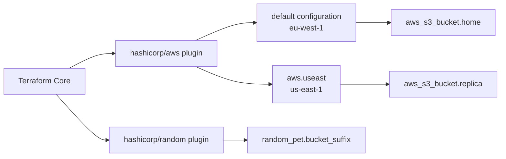

# Lab 2 — One configuration, two AWS providers

Terraform can manage resources in two AWS regions from one configuration, but not because a single provider block magically knows both. The same `hashicorp/aws` plugin is configured twice: once as the default and once under an alias. Each resource then chooses which configuration to use. This lab makes that chain visible: from `required_providers` to the lock file, from the default provider to the alias, and from the plan to the state.

The infrastructure is intentionally small—one random suffix and two S3 buckets. The buckets are not the lesson. The lesson is the wiring. Once you can read this configuration, the same pattern scales to multi-region and multi-account layouts.

> Strictly, this is one provider type (`hashicorp/aws`) with two provider configurations. "Two AWS providers" is shorthand; Terraform downloads one AWS plugin.

## The mental model: Core, plugins, and configurations

Terraform Core parses HCL, builds the dependency graph, and decides what must change. It does not know how to create an S3 bucket. That knowledge lives in the provider plugin. Core asks the plugin to plan and apply a resource; the plugin translates that request into AWS API calls and maps the response back into state.

The provider is not part of the `terraform` binary. `terraform init` downloads it from the registry and records the exact selection in `.terraform.lock.hcl`. This separation is why you can update the AWS provider without replacing Terraform itself, and why `init` is the command that needs registry access.

`required_providers` declares the plugin you need:

```hcl
terraform {
  required_version = ">= 1.12.0"

  required_providers {
    aws = {
      source  = "hashicorp/aws"
      version = "~> 5.0"
    }
    random = {
      source  = "hashicorp/random"
      version = "!= 3.5.0"
    }
  }
}
```

The local name `aws` is the prefix used by resource types such as `aws_s3_bucket`. `source` says where the plugin comes from. `version` is a range, not an exact pin; the lock file holds the exact version that `init` selected.

A `provider` block configures an instance of that plugin:

```hcl
provider "aws" {
  region = "eu-west-1"
}

provider "aws" {
  alias  = "useast"
  region = "us-east-1"
}
```

The first block is the default configuration. A resource with no `provider` argument uses it. The second block is the same plugin with a different region, distinguished by `alias`. A resource selects it with `provider = aws.useast`—a reference, not a string. `provider = "aws.useast"` is invalid, and `alias = "useast"` belongs in the provider block, not in the resource.



Two configurations are useful when the resources genuinely belong together: a primary bucket and a regional companion, a global route and a regional origin, or the same stack in two regions. They are a poor fit when the regions have independent lifecycles, because one state and one `destroy` now cover both. An alias does not create a second AWS account or a second plugin; it changes the configuration used for a resource.

## What this checkout declares

| File | What it contains | Why it matters |
|---|---|---|
| `versions.tf` | Terraform `>= 1.12.0`; AWS `~> 5.0`; random `!= 3.5.0` | Declares the plugin requirements and the range `init` may resolve. |
| `providers.tf` | Default AWS in `eu-west-1`; alias `useast` in `us-east-1` | The default is the fallback; the alias is selected explicitly. |
| `main.tf` | `random_pet` suffix; `home` bucket; `replica` bucket with `provider = aws.useast` | Shows the same resource type under two configurations. |
| `outputs.tf` | `suffix`, `home_bucket`, `replica_bucket` | Makes the generated names visible without reading state. |
| `.terraform.lock.hcl` | AWS `5.100.0`; random `3.9.0`; constraints and hashes | Pins the exact plugins this checkout resolved. |
| `terraform.tfstate` | Local runtime state, if generated | Tracks resources for this working directory; keep it private. |
| `terraform.tfstate.backup` | Possible local state backup | Keep it private; it is not a replacement for a backup strategy. |

The lock selections describe this repository snapshot; `init -upgrade` can change them. State is specific to your own working directory and is not shipped in a fresh clone.

The constraints deserve a close reading because they are the part most likely to be misunderstood under exam pressure.

`~> 5.0` means "at least 5.0.0, below 6.0.0." It allows 5.100.0 and any later 5.x release, but it will not select 6.0.0. The lock file currently records 5.100.0, so that is the exact version this checkout resolved. The constraint did not choose that number by itself; `init` chose the newest version that satisfied the range when it ran, and the lock preserved the choice.

`!= 3.5.0` means "any version except 3.5.0." It does not mean "3.5.0 or newer"; it also does not exclude 3.5.1. This is a deliberately awkward constraint for demonstrating the operator, not a model production policy: with no upper bound, a future major version would also satisfy it. The lock records 3.9.0.

`required_version` and `required_providers` are separate guards. The first checks the Terraform CLI; the second checks the plugins. A machine can have a new enough CLI and an incompatible provider, or the reverse. `terraform version` shows the CLI and, once providers are installed, the versions selected in the working directory.

The lesson notes that AWS provider 6.x exists; this lab intentionally stays on 5.x. `init -upgrade` will therefore not cross the major boundary. Moving to 6.x is a deliberate constraint change followed by a review of the provider's breaking changes, not something a routine upgrade should do silently.

The lock file is the difference between "I asked for a range" and "this is the exact package that was verified." It belongs in version control. The `.terraform/` directory is a platform-specific cache; it does not. State and its backups are local runtime data, not source.

### Coverage of lesson L2

| Lesson objective | Where this lab exercises it |
|---|---|
| 2a — Install and version providers | `init`, the lock file, `init -upgrade` |
| 2b — How Terraform uses providers | Core/plugin model, `terraform providers`, plan |
| 2c — Multiple providers in one configuration | `alias`, `provider = aws.useast`, region verification |
| 2d — State and provider configurations | `state list`, state snapshots, destroy |

## Lesson versus this checkout

The course lesson `../../../lessons/02-providers-versiones.md` teaches the same mechanisms, but its hands-on example is not identical to this directory. The differences are small and deliberate; they matter as soon as you copy a command.

| Aspect | Lesson L2 | This checkout |
|---|---|---|
| Default AWS region | `us-east-1` | `eu-west-1` |
| Alias | `europe` → `eu-west-1` | `useast` → `us-east-1` |
| Bucket resources | `primary`, `europe` | `home`, `replica` |
| Outputs | not shown in the exercise snippet | `suffix`, `home_bucket`, `replica_bucket` |
| Apply style | `terraform apply -auto-approve` | review the plan and approve interactively |
| Random constraint in Example 1 | `= 3.6.0` | `!= 3.5.0` (same as the lesson's hands-on step) |
| Resolved versions in the lesson's illustrative output | `5.x.x`, `3.6.0` | lock records `5.100.0`, `3.9.0` |

The lesson's Step 5 verification commands look for buckets named `lab2-primary-*` and `lab2-europe-*`. This checkout creates `lab2-home-*` and `lab2-replica-*`. If a command from the lesson does not match your output, check the prefix before assuming the apply failed.

The lesson's Example 1 also adds an `archive` provider; this checkout does not. The hands-on step uses only AWS and random, which matches the actual files. The lesson's `-auto-approve` flag is convenient in a disposable sandbox, but it removes the review step. This guide keeps the review: read the plan, confirm the three resource additions, then approve. The lesson's version numbers are illustrative; the lock file in this checkout is the evidence, and it records different exact versions.

The lesson's selective commit in Step 7 adds `versions.tf`, `providers.tf`, `main.tf`, and `.terraform.lock.hcl`. This checkout also has `outputs.tf`, so include it. Do not add state or the provider cache.

## Before you run anything

You need Terraform 1.12.0 or newer, network access to the provider registry for `init`, and AWS credentials for an isolated sandbox account with S3 permissions in both `eu-west-1` and `us-east-1`. The AWS CLI is optional; it is used only to verify bucket locations and cleanup.

The two provider blocks do not contain credentials. The AWS provider uses its normal credential chain—environment variables, a shared profile, SSO, or an instance role. The alias changes the region, not the identity. If you need two different accounts, add `profile` or `assume_role` to each provider block; that is beyond this lab. Never put access keys in `.tf` files, tags, or this README.

Bucket names are globally unique across all AWS accounts. The random suffix makes a collision unlikely, not impossible. Never use a name you do not own, and do not treat the generated name as reserved.

The configuration creates real S3 buckets. A plan is not an apply. Use a sandbox account, not production. The configuration does not add public access, but it also does not prove your account-level Block Public Access settings; do not put sensitive data in these buckets. State contains resource metadata and can contain sensitive values in other configurations; do not commit or publish it.

The lesson's cost section describes the provider-theory portion as local and $0.00; the hands-on apply still creates two real buckets. Bucket creation itself has no separate charge, but requests and stored objects can be billed. This lab creates no objects, so if you destroy promptly the expected charge is effectively zero, but AWS billing is not guaranteed to be exactly zero because requests are billable. The lesson's "$0.00" is a planning estimate, not a quote. There are no NAT gateways, instances, or other hourly resources here.

Your working directory may contain `terraform.tfstate`, state backups, and a `.terraform/` cache. Treat them as local artifacts and exclude them from publication; the lock file is the exception and should be committed.

## Practice

### Lab 1 — Inspect, validate, and plan without creating resources

**Objective:** read the configuration, confirm the provider resolution, and produce a plan that adds three resources without changing AWS.

**Prerequisites:** Terraform 1.12.0+, registry access, and a terminal in this directory. AWS credentials are not required for `fmt` or `validate`; `plan` may need them because the AWS provider can validate credentials.

**Steps:**

```sh
terraform version
terraform init
terraform fmt -check
terraform validate
terraform providers
terraform plan
terraform state list
```

Read `.terraform.lock.hcl` after `init` and compare its `version` and `constraints` fields with `versions.tf`. Then read the plan output before doing anything else. These expectations assume the empty state in this checkout. If you have already applied here, run `terraform destroy` first or work from a fresh copy; otherwise the plan will describe existing resources rather than three additions.

**Expected result:** `init` succeeds and either downloads the providers or reuses the versions already in the lock file. `fmt -check` exits 0; if it reports files, run `terraform fmt` and review the diff. `validate` prints `Success! The configuration is valid.` Under `Providers required by configuration`, `terraform providers` shows one `hashicorp/aws` requirement and one `hashicorp/random` requirement, with the constraints from `versions.tf`—not two separate AWS plugins. With empty state, the plan proposes three additions: `random_pet.bucket_suffix`, `aws_s3_bucket.home`, and `aws_s3_bucket.replica`. The bucket names appear as `(known after apply)` because the random suffix does not exist until apply. A plan does not create resources or add them to state.

A representative plan tail:

```text
Plan: 3 to add, 0 to change, 0 to destroy.
```

**Solution:** With empty state, a correct run ends with a valid configuration and a three-resource plan; the state remains empty. If the plan shows a different count, inspect your existing state and compare your files with the table above before applying. If `init` selects different versions, remember that the lock is authoritative for this checkout; do not edit it by hand. If `plan` fails on credentials, configure a sandbox profile and retry; do not paste keys into the configuration.

**Criteria:** you can explain why `terraform providers` shows one AWS requirement despite two provider blocks, why the bucket names are unknown at plan time, and why the state is still empty after planning.

### Lab 2 — Apply, verify both regions, and destroy

**Objective:** create the two buckets, prove which provider configuration each one used, and remove everything cleanly.

**Prerequisites:** Lab 1 passed, a reviewed plan, a sandbox AWS account, and permission to create and delete S3 buckets in both regions. The state must contain only this lab's three resources; never run `destroy` in a directory that manages shared infrastructure. This step creates billable resources, even if the amount is tiny.

**Steps:**

```sh
terraform apply
terraform output
terraform state list
```

Review the plan and type `yes` only if it shows the same three additions you inspected. For a stricter review, save the plan with `terraform plan -out=lab2.tfplan`, inspect it with `terraform show lab2.tfplan`, and apply that file; do not commit the plan file. Then verify the regions from AWS, not from the tags:

```sh
aws s3api get-bucket-location \
  --bucket "$(terraform output -raw home_bucket)" \
  --region eu-west-1

aws s3api get-bucket-location \
  --bucket "$(terraform output -raw replica_bucket)" \
  --region us-east-1
```

Run `terraform plan` once more to check idempotence:

```sh
terraform plan
```

Then clean up:

```sh
terraform destroy
terraform state list
```

Review the destroy plan and approve it only when it lists the three resources you created.

**Expected result:** With empty state, `apply` reports `3 added, 0 changed, 0 destroyed` and prints the three outputs. The `suffix` output is the `random_pet` id; the bucket outputs are `lab2-home-<suffix>` and `lab2-replica-<suffix>`. `terraform state list` shows the two buckets and the random pet. The first `get-bucket-location` returns `"eu-west-1"`. The second returns `null` (or omits the location), which is how S3 reports the `us-east-1` default region—not an error and not evidence that the bucket is elsewhere. The second `terraform plan` reports no changes if nothing has changed. After reviewing and applying the destroy, the state list should be empty.

**Solution:** the default bucket is in `eu-west-1`; the alias bucket is in `us-east-1`; both names share the same suffix; there are no replication resources. Confirm the actual bucket locations in AWS after applying.

If `destroy` fails with `BucketNotEmpty`, the bucket still has objects or versions. Empty it with a reviewed procedure, then retry. Do not use an unchecked recursive delete against a name you have not confirmed.

**Criteria:** before destroy, both buckets exist in the intended regions; the outputs are consistent; a second plan is clean; destroy removes both buckets and the random pet; the final state is empty. The `Region` tags are not proof of location—they are metadata written by the configuration and would remain misleading if the alias were wrong.

## Experiments

These exercises change only local files or the provider cache. Restore each file before applying; a broken configuration should never reach `apply`.

### Lock versus freshness

Run `terraform init` again without changing anything. Terraform should reuse the versions recorded in `.terraform.lock.hcl` rather than silently jumping to newer releases. Then run:

```sh
terraform init -upgrade
```

This re-resolves the constraints and may update the lock file. Whether it actually changes a version depends on what is available: if no newer compatible release exists, the lock stays the same. The point is the mechanism, not a guaranteed version bump. Because `!= 3.5.0` has no upper bound, a random provider major release is also eligible for `init -upgrade`; review the lock diff instead of assuming only patches move. Commit the lock diff if there is one, and never hand-edit the `version` or `hashes` fields.

### Cache versus lock

The `.terraform/` directory is disposable. From this directory only, remove it and re-run `init`:

```sh
rm -rf .terraform
terraform init
```

Terraform restores the locked versions into the cache. The lock file survives, so the selection does not change. Do not delete `terraform.tfstate` in this experiment; that is a different kind of loss.

If you delete the lock file instead, a later `init` has no pin to respect and will resolve the constraints afresh. That is not the supported update path: you lose the before/after record and can jump versions without a reviewed diff. Prefer `init -upgrade`.

### The alias is a reference, not a string

Temporarily change the replica resource to:

```hcl
provider = "aws.useast"
```

Run `terraform validate`. It should reject the quoted value as an invalid provider configuration reference; the exact wording varies by Terraform version. Restore `provider = aws.useast` before continuing. This is the syntax the exam is most likely to test.

A subtler variant: remove the `provider` line entirely. `validate` will pass, and the plan will still propose three resources—but both buckets now use the default `eu-west-1` configuration. The `Region = "us-east-1"` tag remains, so the configuration becomes internally misleading. `validate` checks references and types; it does not check that your tag matches your provider. Restore the line.

### Two default configurations are not allowed

Remove `alias = "useast"` from the second provider block and run `terraform validate` or `terraform init`. Terraform should reject the duplicate default configuration for the same provider type. The alias exists precisely to distinguish the second configuration. Restore it.

### Constraint arithmetic on paper

Without running anything, decide whether each version satisfies the constraint:

| Constraint | `5.0.0` | `5.100.0` | `6.0.0` | `3.5.1` |
|---|---|---|---|---|
| `~> 5.0` | yes | yes | no | no |
| `~> 5.0.0` | yes | no | no | no |
| `!= 3.5.0` | yes | yes | yes | yes |

`~> 5.0` allows any 5.x; `~> 5.0.0` allows only 5.0.x; `!= 3.5.0` excludes exactly one version and leaves the rest of the range open. This is why the lock file, not the constraint, is the exact record.

## Troubleshooting

| Symptom | Likely cause | What to do |
|---|---|---|
| `No valid credential sources found` | No AWS credentials visible to the provider | Configure a sandbox profile or SSO; do not hardcode keys. |
| `AccessDenied` or `UnauthorizedOperation` | Missing S3 permissions, wrong account, or wrong region | Check the identity and the permissions in both regions. |
| `BucketAlreadyExists` | The globally unique name is owned by another account | Change the prefix; do not try to claim the name. |
| `BucketAlreadyOwnedByYou` | Your account owns the name but this state does not | Import it or choose a new prefix; do not delete it blindly. |
| `BucketNotEmpty` on destroy | Objects, versions, or delete markers remain | Empty the bucket with a reviewed procedure, then retry. |
| `Invalid provider configuration reference` | `provider = "aws.useast"` with quotes | Use `provider = aws.useast`. |
| `Duplicate provider configuration` | Two default AWS blocks | Add `alias` to the second block. |
| Provider constraint conflict | Two modules or requirements cannot be satisfied together | Read the intersection; change `versions.tf`, then `init -upgrade`; do not edit the lock. |
| `fmt -check` fails | Files are not canonically formatted | Run `terraform fmt`, review the diff, and commit it. |
| Plan wants to replace both buckets after a suffix change | `bucket` is a ForceNew attribute; a new name means a new bucket | Understand the replacement before approving; old buckets may be destroyed. |

## Check yourself

These questions check the lab's wiring; they do not replace the six-question bank in lesson L2. Complete both before treating the lesson as closed.

1. **Why does `terraform providers` show one AWS requirement when there are two `provider "aws"` blocks?** Requirements describe the plugin; the blocks describe two configurations of that same plugin. The alias is not a second provider type.
2. **What does `~> 5.0` allow, and why do you still need the lock file?** It allows `>= 5.0.0, < 6.0.0`. The lock records the exact version and hashes selected inside that range, so every machine resolves the same package.
3. **Does `!= 3.5.0` allow `3.5.1`?** Yes. It excludes exactly `3.5.0`, not the whole 3.5 series, and it imposes no upper bound.
4. **Which resource uses the alias, and how would you prove it?** `aws_s3_bucket.replica` uses `aws.useast`. Read the configuration, then verify the bucket location from AWS or inspect the provider recorded in state; the `Region` tag alone is not proof.
5. **Why does `get-bucket-location` return `null` for the replica?** `us-east-1` is the S3 default; the API reports no explicit location constraint for it. `null` means `us-east-1`, not "unknown."
6. **What does `terraform plan` show after `destroy`?** It proposes the same three resources again, because the configuration still declares them. Destroy removes infrastructure, not the configuration.
7. **Why commit `.terraform.lock.hcl` but not `terraform.tfstate`?** The lock pins plugins reproducibly and contains no environment data. State records this deployment's resources and may contain sensitive values; it belongs in a protected backend, not the repository.

## Repository hygiene

Commit the configuration and the lock file:

```text
versions.tf
providers.tf
main.tf
outputs.tf
.terraform.lock.hcl
README.md
```

Do not commit:

```text
.terraform/
*.tfstate
*.tfstate.*
*.tfplan
```

State, backups, and the provider cache are local artifacts, not templates. Exclude them when publishing; if they were already committed, removing files from the working tree is not enough to erase them from history.

## Sources and verification

This README is based on the course lesson `../../../lessons/02-providers-versiones.md`, the files in this directory, and the teaching sequence in `../../../TUTORING_CONTRACT.md`. The lesson supplies the provider/alias, version-constraint, and lock-file explanations; this checkout supplies the concrete regions, names, constraints, and resolved versions. The contract's checklist—cover the lesson's objectives, examples, exercise, and question bank before recording progress—is why the lab maps each L2 objective to a concrete step and ends with a self-check rather than a command list. The lab does not write or modify `progress.json`; completion is a separate tutoring decision.

Verification is static. The configuration and lock file were inspected, but no Terraform or AWS commands were run for this guide and no AWS resources were created or verified. Expected results depend on your credentials, state, account, and provider versions.
