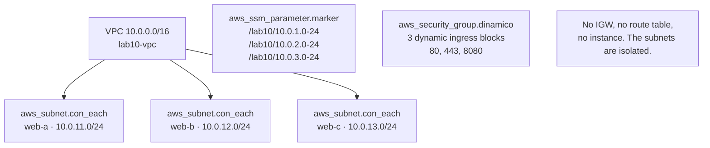

# Lab 10 — Dynamic expressions: `for_each`, `dynamic` blocks, and splat


Lab 9 created subnets with `count`. That works when the instances are interchangeable and their position is the only identity they need. This lab changes the question: what happens when a subnet has a name, a CIDR, and an AZ that must stay attached to that name even if another subnet disappears? The answer is `for_each`, which addresses instances by stable keys instead of numeric positions. The lab also generates repeated nested blocks with `dynamic` and turns a map of resources into a list with a splat expression.

The configuration is deliberately compact: one `main.tf` contains the provider, the variables, one data source, a VPC, three subnets keyed by name, three SSM parameters keyed by CIDR, and a security group with three dynamic ingress rules. There is no internet gateway, no route table, and no instance. The subnets are isolated, and the security group is not attached to anything. That keeps the focus on expression mechanics and keeps the cost near zero.

**In this guide:** [What this lab teaches](#what-this-lab-teaches) · [Architecture](#architecture) · [Inputs](#inputs) · [Reading the configuration](#reading-the-configuration) · [Practice](#practice) · [Troubleshooting](#troubleshooting) · [Costs and safety](#costs-and-safety) · [Self-check](#check-your-understanding) · [Cleanup](#cleanup-and-reset)

## What this lab teaches

- Use `for_each` with a map to give each subnet a stable, human-readable identity.
- Use `for_each` with a set to iterate over unique strings such as CIDRs.
- Explain why `for_each` accepts a map or a set but not a list.
- Read `each.key` and `each.value` correctly in both cases.
- Generate nested blocks with `dynamic` and a custom `iterator`.
- Recognize when a nested block is processed in attributes-as-blocks mode and why an empty `dynamic` collection does not purge existing rules.
- Build a map with a `for` expression and a list with `values(...)[*].id`.
- Decide between `count` and `for_each` based on identity, removal behavior, and production risk.

## Architecture



The diagram shows two independent collections. The subnets are keyed by name (`web-a`, `web-b`, `web-c`) and have CIDRs `10.0.11.0/24`, `10.0.12.0/24`, and `10.0.13.0/24`. The SSM parameters are keyed by a different list of CIDRs (`10.0.1.0/24`, `10.0.2.0/24`, `10.0.3.0/24`) and store those strings as parameter values. The two CIDR sets are not linked; the SSM parameters are markers for the expression, not the subnet addresses. That separation is intentional and easy to miss.

The security group exists only to demonstrate `dynamic`. It has no attached ENI or instance, so no traffic reaches it. Its three ingress blocks are generated from `var.ingress_rules`; the egress block is written once and is not dynamic.

## The files in front of you

| Path | Role |
| --- | --- |
| `main.tf` | Terraform block, provider, variables, data source, resources, outputs |
| `.terraform.lock.hcl` | AWS 5.100.0 in this working copy |

The single-file layout is intentional for this lab: the expression is the subject, and splitting the configuration across six files would add navigation without adding a concept. In a larger module, the variables, locals, resources, and outputs would be separated as they are in Labs 8 and 9.

There is no `terraform.tfvars` in the checkout. The variables have defaults, so the lab runs without one. If you create a `terraform.tfvars` for an experiment, remember that the repository ignores `*.tfvars`; it will not be committed, and it can contain values you do not want to publish.

## Inputs

| Input | Type | Default | What it controls |
| --- | --- | --- | --- |
| `subnet_cidrs` | `list(string)` | Three `/24` CIDRs | The values stored in the SSM parameters |
| `subnets` | `map(object({ cidr = string, az_idx = number }))` | Three named subnets | The VPC subnets and their AZ indexes |
| `ingress_rules` | `list(object({ description = string, port = number, cidr_blocks = list(string) }))` | HTTP, HTTPS, HTTP/8080 | The security group's dynamic ingress blocks |

The two CIDR inputs look similar but do different jobs. `subnet_cidrs` is a list of strings used only by the SSM parameters. `subnets` is a map whose values contain a `cidr` and an `az_idx`; those are the real subnet addresses. Changing `subnet_cidrs` does not move a subnet. Changing `subnets` does not update an SSM parameter. The lab is easier to read once you keep those two paths separate.

`az_idx` is a zero-based index into the AZ names returned by the data source. The default map uses `0`, `1`, and `3`, so `web-c` lands in the fourth AZ, not the third. In `us-east-1`, the data source usually returns six AZs, so index `3` is valid. In a region with fewer AZs, the index fails. The gap is deliberate: it shows that the key is independent of the AZ position, and that an index is still an index even when the key is a name.

## Reading the configuration

### `for_each` over a map: named subnets

```hcl
resource "aws_subnet" "con_each" {
  for_each          = var.subnets
  vpc_id            = aws_vpc.main.id
  cidr_block        = each.value.cidr
  availability_zone = data.aws_availability_zones.available.names[each.value.az_idx]

  tags = {
    Name = "lab10-foreach-${each.key}"
  }
}
```

`var.subnets` is a map, so Terraform creates one instance per key. The instance addresses are `aws_subnet.con_each["web-a"]`, `aws_subnet.con_each["web-b"]`, and `aws_subnet.con_each["web-c"]`. `each.key` is the map key; `each.value` is the object `{ cidr = ..., az_idx = ... }`. The AZ lookup uses `each.value.az_idx` as an index into the list of AZ names. The `Name` tag uses `each.key`, so the tag and the address share the same identity.

The important property is removal behavior. If you delete `"web-b"` from the map, Terraform destroys only `aws_subnet.con_each["web-b"]`. The other two addresses do not change. With `count`, deleting the second of three instances would shift the third into index `1`, and Terraform would see a different instance at that address. That is the renumbering trap in one sentence.

A map also gives you a place to attach more attributes later. If a subnet needs a different `map_public_ip_on_launch` value, you can add it to the object and read `each.value.map_public_ip_on_launch`. A `count`-based list can do the same with parallel lists, but the mapping between positions becomes implicit and easier to break.

### `for_each` over a set: unique CIDRs

```hcl
resource "aws_ssm_parameter" "marker" {
  for_each = toset(var.subnet_cidrs)
  name     = "/lab10/${replace(each.key, "/", "-")}"
  type     = "String"
  value    = each.key
}
```

`for_each` does not accept a list, because a list can contain duplicates and its order can change. It accepts a map or a set. `toset(var.subnet_cidrs)` converts the list into a set of unique strings; the set has no meaningful order. In a set of strings, `each.key` and `each.value` are the same string. That is why the parameter uses `each.key` for both the name and the value.

The `replace` call is necessary because a CIDR contains `/`, and the parameter name would otherwise contain an extra path separator. `replace("10.0.1.0/24", "/", "-")` produces `10.0.1.0-24`, so the full name is `/lab10/10.0.1.0-24`. The name is valid for SSM Parameter Store, and the value is the original CIDR string.

Two consequences follow from `toset`:

- Duplicate CIDRs collapse into one parameter. If `subnet_cidrs` contains `10.0.1.0/24` twice, the set has one element and Terraform creates one parameter, not two.
- Reordering the list does not create new parameters. The set keys are the strings themselves, so the same CIDR keeps the same address even if it moves in the list.

The SSM parameters are account- and region-scoped names. Applying this lab from two different states in the same account and region will collide on `/lab10/10.0.1.0-24` unless the first set is destroyed or the names are changed. That is a property of the lab's fixed prefix, not of `for_each`.

### `dynamic` blocks: generated ingress rules

```hcl
resource "aws_security_group" "dinamico" {
  name        = "lab10-dynamic-sg"
  description = "SG with dynamic rules"
  vpc_id      = aws_vpc.main.id

  dynamic "ingress" {
    for_each = var.ingress_rules
    iterator = regla

    content {
      description = regla.value.description
      from_port   = regla.value.port
      to_port     = regla.value.port
      protocol    = "tcp"
      cidr_blocks = regla.value.cidr_blocks
    }
  }

  egress {
    from_port   = 0
    to_port     = 0
    protocol    = "-1"
    cidr_blocks = ["0.0.0.0/0"]
  }
}
```

A `dynamic "ingress"` block generates zero or more nested `ingress` blocks inside the security group. It does **not** create a security group per rule. The resource is still one `aws_security_group.dinamico`; the generated blocks are part of its configuration. This is the distinction the exam likes to test: `count` and `for_each` create resource instances; `dynamic` generates nested blocks inside one resource.

`for_each = var.ingress_rules` iterates over the list of objects. `iterator = regla` gives the loop a readable name; without it, the default name would be `ingress`, and the content would read `ingress.value.description`. The iterator's `key` is the list index (`0`, `1`, `2`), and its `value` is the object. The content block maps the object's `description`, `port`, and `cidr_blocks` to the provider's `ingress` arguments. `from_port` and `to_port` both use `port`, so each rule opens a single TCP port.

The default list has three rules: HTTP/80, HTTPS/443, and HTTP/8080, all from `0.0.0.0/0`. The security group therefore has three ingress blocks. If `var.ingress_rules` is an empty list, the dynamic block generates no ingress blocks at all; on a new security group, the group is created with only the egress rule. On an existing group, the absence of blocks does not purge rules already in state; Experiment 4 covers that attributes-as-blocks caveat. If you add a fourth object, Terraform updates the existing security group in place; it does not replace the group.

`dynamic` can generate blocks that the provider schema defines, such as `ingress`, `egress`, `route`, or `setting`. It cannot generate a `resource` block, and it cannot generate meta-arguments such as `lifecycle` or `depends_on`. It is a configuration-generation tool, not a resource-generation tool.

### Outputs: a map and a list

```hcl
output "subnet_ids_foreach" {
  value = { for k, s in aws_subnet.con_each : k => s.id }
}

output "subnet_ids_lista" {
  value = values(aws_subnet.con_each)[*].id
}
```

The first output is a `for` expression over the resource map. It keeps the keys and replaces each subnet object with its `id`, producing a map such as `{ "web-a" = "subnet-..." , "web-b" = "subnet-..." , "web-c" = "subnet-..." }`. The second output uses `values()` to turn the resource map into a list of subnet objects, then the splat expression `[*].id` to extract the IDs. The result is a list of IDs.

`values()` returns values in lexical order of their keys, not in the order they appear in the configuration. With keys `web-a`, `web-b`, and `web-c`, lexical order matches the obvious order. If the keys were `web-10`, `web-2`, and `web-1`, the list order would surprise you. When order matters, use an explicit `for` expression with a sorted key list or keep the map output. A splat expression is convenient for a list of values, but it does not promise an order that the underlying collection does not have.

### `count` versus `for_each`

| Criterion | `count` | `for_each` |
| --- | --- | --- |
| Identity | Numeric position (`[0]`, `[1]`) | Stable key (`["web-a"]`) |
| Removing an element | Later elements can renumber | Only the removed key is affected |
| Input type | Number | Map or set |
| Duplicate values | Allowed | Sets deduplicate; map keys must be unique |
| Empty collection | `count = 0` | `for_each = {}` or `toset([])` |
| Production default | Fine for identical, interchangeable instances | Preferred when identity matters |

Lab 9 uses `count` because its public subnets are interchangeable positions in a generated list. Lab 10 uses `for_each` because each subnet has a name that must survive changes to its neighbors. Neither is universally better; the question is whether the instance's identity is its position or its key.

### What a plan creates

From an empty state, the plan summary is:

```text
Plan: 8 to add, 0 to change, 0 to destroy.
```

The eight resources are the VPC, three subnets, three SSM parameters, and the security group. The `aws_availability_zones` data source is read during the plan but is not counted in the summary. The security group has three ingress blocks, but it is still one resource.

| Resource | Count | State address shape |
| --- | --- | --- |
| `aws_vpc.main` | 1 | `aws_vpc.main` |
| `aws_subnet.con_each` | 3 | `aws_subnet.con_each["web-a"]` |
| `aws_ssm_parameter.marker` | 3 | `aws_ssm_parameter.marker["10.0.1.0/24"]` |
| `aws_security_group.dinamico` | 1 | `aws_security_group.dinamico` |

The addresses in the table are the part to watch. They show whether Terraform is tracking identity by key or by position, and they explain why removing a map entry is safer than removing a list element.

## Prerequisites and safety

- Terraform **1.12.0** or newer. The configuration's `required_version` is `>= 1.12.0`.
- AWS credentials with permissions for VPC, subnet, SSM Parameter Store, and security group operations.
- The provider region is fixed to `us-east-1`. The default `az_idx = 3` assumes at least four AZs; `us-east-1` usually has six. If you change the region, check the AZ count and adjust the indexes.
- `terraform plan` reads `aws_availability_zones.available`, so it needs AWS credentials even though it creates nothing.
- Applying creates eight resources: a VPC, three subnets, three SSM parameters, and one security group. There is no EC2 instance, no NAT gateway, and no internet gateway. The direct cost is low; standard SSM parameters have no additional charge, and the VPC/subnet/security group resources themselves are free. You still pay for anything you add later.
- The subnets are isolated. They have no route to the internet, and the security group is not attached to an instance. Do not mistake this lab for a working public network.
- SSM parameter names are account- and region-scoped. The fixed `/lab10/...` prefix can collide with another apply. Destroy the first set or change the prefix before running a second copy.
- Do not commit state, plan files, credentials, or `.terraform/`. The lock file is safe to commit.

## Practice

The experiments assume you are in `labs/w02/lab10-dinamico`. Show the actual command output when you study with a tutor; the state addresses and plan symbols are the evidence.

### Experiment 1 — Establish the baseline

**Objective:** Confirm that the configuration initializes, validates, and plans eight resources with the expected addresses.

**Steps:**

```sh
terraform init
terraform state list
terraform fmt -check
terraform validate
terraform plan
```

**Expected result:** `init` installs AWS 5.100.0 or reports it as previously installed. `state list` prints nothing if the checkout is empty; if it lists resources from an earlier run, destroy them or work in a scratch copy before expecting the eight-resource count. `fmt -check` prints nothing. `validate` reports `Success! The configuration is valid.` The plan ends with `Plan: 8 to add, 0 to change, 0 to destroy.` and lists the `aws_availability_zones` data source being read.

**Solution:** The solution is the command sequence. If the plan count differs, check `pwd`, `terraform state list`, and whether a `terraform.tfvars` from an earlier experiment is still present.

**Criteria:** You can explain why the security group's three ingress blocks do not make the plan count three security groups.

### Experiment 2 — Add and remove a named subnet

**Objective:** Prove that `for_each` keeps the surviving subnets at the same addresses when a sibling is added or removed.

**Steps:**

Apply the baseline first, so the three default subnets exist:

```sh
terraform apply
```

Then create a `terraform.tfvars` with the full map plus a fourth subnet:

```hcl
subnets = {
  "web-a" = { cidr = "10.0.11.0/24", az_idx = 0 }
  "web-b" = { cidr = "10.0.12.0/24", az_idx = 1 }
  "web-c" = { cidr = "10.0.13.0/24", az_idx = 3 }
  "web-d" = { cidr = "10.0.14.0/24", az_idx = 4 }
}
```

Run:

```sh
terraform plan
terraform apply
terraform state list | grep 'aws_subnet.con_each'
```

Then remove the `"web-b"` entry from `terraform.tfvars` and run `terraform plan` again. Do not apply the removal until you have read the plan.

**Expected result:** The first plan adds exactly one subnet, `aws_subnet.con_each["web-d"]`; the other three addresses are unchanged. The state list shows four keyed addresses. After removing `"web-b"`, the plan destroys exactly `aws_subnet.con_each["web-b"]`; `web-a`, `web-c`, and `web-d` keep their addresses. There is no renumbering.

**Solution:** `for_each` uses the map keys as identity. Adding a key creates one new instance; removing a key destroys that instance. The other keys are untouched. The `az_idx = 4` value requires at least five AZs; in `us-east-1`, the data source usually returns six. If your region has fewer, use an index that exists.

**Criteria:** You can explain why the same experiment with `count` would be riskier: removing the second of four instances would shift the third and fourth into new positions, and Terraform would plan changes that are not about the removed instance.

Before Experiment 3, remove `terraform.tfvars` (or restore the original three-subnet map) and run `terraform apply` so the baseline is back to eight resources. The later experiments assume that baseline.

### Experiment 3 — Deduplicate a set

**Objective:** See how `toset` changes the number of SSM parameters when the input list contains duplicates.

**Steps:**

```sh
terraform plan -var 'subnet_cidrs=["10.0.1.0/24", "10.0.1.0/24", "10.0.2.0/24"]'
```

If the baseline has already been applied, read the plan as a change from three parameters to two; otherwise read it as a plan for two parameters.

**Expected result:** The set has two unique elements, so Terraform manages two `aws_ssm_parameter.marker` instances: one for `10.0.1.0/24` and one for `10.0.2.0/24`. The duplicate does not create a third parameter. If the baseline had three parameters, the plan destroys the parameter for `10.0.3.0/24` because it is no longer in the set.

**Solution:** `toset` removes duplicates and discards order. The set's keys are the strings themselves, so the parameter addresses are `aws_ssm_parameter.marker["10.0.1.0/24"]` and `aws_ssm_parameter.marker["10.0.2.0/24"]`. The `replace` call still turns each key into a valid SSM name.

**Criteria:** You can explain why `for_each = var.subnet_cidrs` would fail here and why `for_each = toset(var.subnet_cidrs)` succeeds.

### Experiment 4 — Empty the dynamic ingress list

**Objective:** Observe that an empty `dynamic` collection emits zero blocks, and that zero blocks do not remove existing rules because `ingress` is processed in attributes-as-blocks mode.

**Steps:**

```sh
terraform plan -var 'ingress_rules=[]'
```

If the baseline is applied, read the plan for `aws_security_group.dinamico`. Then, in a scratch copy only, remove the `dynamic "ingress"` block and replace it with `ingress = []` to see the purge path. Do not put both forms in the same resource.

**Expected result:** The dynamic block emits zero `ingress` blocks. If the security group already exists, the three rules remain and the plan may report no changes to the group; the egress block remains. From an empty state, the security group is created with no ingress blocks, and the resource count is eight. The group is not replaced. In the scratch copy, `ingress = []` explicitly removes the managed rules.

**Solution:** `dynamic "ingress"` generates normal nested blocks, but `aws_security_group.ingress` is processed in [attributes-as-blocks](https://developer.hashicorp.com/terraform/language/attr-as-blocks) mode. In that mode, omitting the blocks means "ignore existing objects", not "remove them"; an explicit `ingress = []` is the purge signal. The two forms cannot be mixed in one resource. This is a provider-specific caveat, and it is why the lab's dynamic example is about generating rules, not about deleting them.

**Criteria:** You can explain why an empty dynamic collection does not remove the three existing rules, what syntax would remove them, and why `ingress = []` and `dynamic "ingress"` cannot coexist in the same resource.

### Experiment 5 — Drill `for` expressions and `values`

**Objective:** Evaluate the collection expressions outside the resource graph.

**Steps:**

```sh
terraform console
```

Evaluate:

```hcl
toset(["a", "a", "b"])
values({ a = 1, b = 2 })
{ for k, v in { a = 1, b = 2 } : k => v * 2 }
[for s in ["a", "b"] : upper(s)]
length(toset(["a", "a", "b"]))
```

**Expected result:** `toset(["a", "a", "b"])` is a set with two elements, `"a"` and `"b"`. `values({ a = 1, b = 2 })` is `[1, 2]`. The `for` expression produces `{ "a" = 2, "b" = 4 }`. The list comprehension produces `["A", "B"]`. The length is `2`.

**Solution:** Sets deduplicate; `values` returns a list in lexical key order; a `for` expression can build a map or a list depending on whether it uses `key => value` or a single expression. The `upper` call is a string function applied to each element.

**Criteria:** You can predict `values({ z = 1, a = 2 })` and explain why the order is `[2, 1]`, not `[1, 2]`.

### Experiment 6 — Compare the state addresses with Lab 9

**Objective:** See the difference between positional and keyed identity in the actual state.

**Steps:**

If Lab 9 is applied, run:

```sh
cd ../lab9-functions
terraform state list | grep 'aws_subnet'
cd ../lab10-dinamico
terraform state list | grep 'aws_subnet'
```

If Lab 9 is not applied, read the `aws_subnet.public` block in its `main.tf` and compare it with the `aws_subnet.con_each` block here.

**Expected result:** Lab 9 shows addresses such as `aws_subnet.public[0]`, `aws_subnet.public[1]`, and `aws_subnet.public[2]`. Lab 10 shows `aws_subnet.con_each["web-a"]`, `aws_subnet.con_each["web-b"]`, and `aws_subnet.con_each["web-c"]`. The first set is positional; the second is keyed.

**Solution:** `count` uses the index as the instance key; `for_each` uses the map key or set element. The state address is the visible consequence of that choice. When you remove an instance, the address tells you what Terraform will consider the same object and what it will consider a different one.

**Criteria:** You can explain why `aws_subnet.public[2]` might refer to a different real subnet after a list change, while `aws_subnet.con_each["web-c"]` keeps referring to the same named subnet.

### Experiment 7 — Clean up

**Objective:** Remove the eight resources and the local experiment files.

**Steps:**

```sh
terraform destroy
terraform state list
rm -f terraform.tfvars
```

**Expected result:** The destroy removes the VPC, three subnets, three SSM parameters, and the security group. `terraform state list` prints nothing. The SSM parameters are deleted from the account and region. If a parameter was created by another state, the destroy may fail with an access or not-found error; investigate before retrying.

**Solution:** The security group is not attached to anything, so it can be deleted without dependency conflicts. The subnets depend on the VPC, so they are destroyed first. The SSM parameters have no dependencies on the VPC; they are independent resources with fixed names. Removing `terraform.tfvars` prevents an experiment value from silently changing the next plan.

**Criteria:** You can explain why the SSM parameters are not destroyed in the same dependency order as the subnets: they do not reference the VPC or the subnets.

## Expected results at a glance

| Command | What success looks like | What it proves |
| --- | --- | --- |
| `terraform init` | AWS 5.100.0 installed | The provider matches the lock and constraint |
| `terraform fmt -check` | No output; exit 0 | Files are canonically formatted |
| `terraform validate` | `Success! The configuration is valid.` | HCL and provider schema are coherent |
| `terraform plan` | `Plan: 8 to add` from an empty state | The collections produce eight resources |
| `terraform state list` | Keyed subnet and SSM addresses | Identity is stored in the state addresses |
| `terraform output subnet_ids_foreach` | Map of name to subnet ID | The `for` expression kept the keys |
| `terraform output subnet_ids_lista` | List of subnet IDs | `values(...)[*].id` extracted the IDs |
| `terraform plan -var 'ingress_rules=[]'` | Zero blocks generated; existing rules are not purged | `dynamic` is not a purge mechanism |
| `terraform destroy` | Eight resources destroyed | Cleanup is part of the workflow |

`plan` success does not prove that every create permission is present. `validate` success does not prove that the AZ indexes are valid in your region. Treat each result as evidence for a narrow claim.

## Troubleshooting

| Symptom | Likely cause | What to do |
| --- | --- | --- |
| `Invalid for_each argument` | You passed a list directly | Use a map or `toset(list)`; `for_each` needs stable keys. |
| `The given "for_each" argument value is unsuitable` | The map has duplicate keys or the set has an unsupported type | Use unique map keys or a set of strings. |
| `Invalid index` on `...names[each.value.az_idx]` | The AZ index is larger than the region's AZ count | Check `data.aws_availability_zones.available.names` and lower the index. |
| `ParameterAlreadyExists` | Another state already owns the same `/lab10/...` name | Destroy the other state's parameter or change the prefix. |
| `ValidationException` on the SSM parameter name | The name contains an unsupported character | Keep the `replace` call; inspect the rendered name. |
| `InvalidGroup.Duplicate` | The security group name already exists in the same VPC | Destroy the old group or change the name. |
| `InvalidSubnet.Conflict` | Two subnets use overlapping CIDRs | Check the `subnets` map; the CIDRs must not overlap. |
| `Unsupported block type` in the dynamic block | The generated block name is not in the provider schema | Use `ingress` or `egress` for a security group. |
| An empty `dynamic` list leaves existing rules | `ingress` is processed in attributes-as-blocks mode; absence means ignore, not remove | Use `ingress = []` in a scratch copy, without the dynamic block. |
| `Error: The "for_each" argument value is unsuitable` with an unknown value | The collection depends on an attribute that is not known until apply | Use keys that are known at plan time; do not build `for_each` from computed resource attributes. |
| `terraform plan` asks for credentials | The AZ data source needs AWS | Configure credentials; this lab always reads one data source. |

## Costs and safety

The lab is cheap by design. It creates a VPC, three subnets, three standard SSM parameters, and one security group. There is no EC2 instance, no NAT gateway, no internet gateway, and no data transfer path. Standard SSM parameters have no additional charge; advanced parameters would. The VPC and subnet resources themselves are free, but any resource you add later is your responsibility.

The safety boundary is equally deliberate:

- The subnets are isolated. They have no internet gateway, no NAT gateway, and no public route table. Do not use this lab as a template for a public network.
- The security group is not attached to an instance. Its three ingress rules are configuration examples, not an exposed service.
- The SSM parameters store CIDR strings, not secrets. They are still account- and region-scoped names; a second apply can collide.
- The `terraform.tfvars` you create for the stable-key experiment is ignored by Git. Remove it when you finish so it does not change a later plan.
- State and plan files can contain resource attributes. Do not commit them. The repository's `.gitignore` excludes `*.tfstate`, `*.tfstate.*`, `.terraform/`, `*.tfvars`, and `tfplan`; the lock file is tracked.

## Check your understanding

1. Why does `for_each` accept a map or a set but not a list?
2. What is the difference between `each.key` and `each.value` when `for_each` iterates over a map? What about a set of strings?
3. Why does `toset(var.subnet_cidrs)` reduce three CIDRs to two parameters when one is duplicated?
4. What does `iterator = regla` change in the dynamic block?
5. Does `dynamic "ingress"` create a new security group for each rule? Explain.
6. Why are the SSM parameters not the same as the subnet CIDRs?
7. What happens to the other subnets when you remove `"web-b"` from the map?
8. Why does `values(...)[*].id` return a list, and what determines its order?

**Answers:**

1. A list can contain duplicates and its order can change, so it does not provide stable keys. `for_each` needs a map or a set of unique keys. `toset` is the usual conversion for a list of strings.
2. In a map, `each.key` is the map key and `each.value` is the value object. In a set of strings, `each.key` and `each.value` are the same string.
3. `toset` removes duplicates. Three input strings with one duplicate become a set of two unique strings, so Terraform creates two parameter instances.
4. It renames the iterator object from the default `ingress` to `regla`, so the content block reads `regla.value` and `regla.key`. It does not change the generated block type or the number of blocks.
5. No. `dynamic` generates nested `ingress` blocks inside the single `aws_security_group.dinamico` resource. `count` or `for_each` on the resource would create multiple security groups.
6. They are independent inputs. `subnet_cidrs` feeds the SSM parameters; `subnets` feeds the VPC subnets. Changing one does not change the other.
7. Only `aws_subnet.con_each["web-b"]` is destroyed. The other keys keep their addresses and their real subnets.
8. `values()` turns the resource map into a list, and the splat `[*].id` extracts the `id` attribute from each element. The order is the lexical order of the map keys, not the order in the configuration.

## Cleanup and reset

Run `terraform destroy` from this directory. If you created a `terraform.tfvars`, remove it with `rm -f terraform.tfvars`. Check `terraform state list`; it should print nothing. If a parameter or security group was created outside this state, the destroy may not see it; inspect the account before deleting anything manually.

If you want to reset only the local cache, remove `.terraform/` and run `terraform init` again. Keep `.terraform.lock.hcl`. Do not delete the lock file to "fix" a provider mismatch; use `terraform init -upgrade` deliberately in a branch or scratch copy.

The working copy may contain `terraform.tfstate` and `terraform.tfstate.backup`. They are local artifacts and are ignored by Git. Do not publish them, even if the current state looks empty.

## What's next

Lab 11 adds lifecycle rules to a small network: `prevent_destroy` protects a bucket, `create_before_destroy` changes the order of a security group replacement, `ignore_changes` tolerates an externally managed tag, and `replace_triggered_by` turns a version variable into a redeploy button. The `for_each` and `dynamic` mechanics from this lab are the foundation for those experiments: the lifecycle rules decide what happens when an instance is replaced, and the collection expressions decide which instances exist.

## References

- Terraform meta-arguments: [`for_each`](https://developer.hashicorp.com/terraform/language/meta-arguments/for_each), [`count`](https://developer.hashicorp.com/terraform/language/meta-arguments/count).
- Terraform expressions: [`dynamic` blocks](https://developer.hashicorp.com/terraform/language/expressions/dynamic-blocks), [`for` expressions](https://developer.hashicorp.com/terraform/language/expressions/for), [splat expressions](https://developer.hashicorp.com/terraform/language/expressions/splat).
- Terraform functions: [`toset`](https://developer.hashicorp.com/terraform/language/functions/toset), [`values`](https://developer.hashicorp.com/terraform/language/functions/values), [`replace`](https://developer.hashicorp.com/terraform/language/functions/replace).
- AWS provider: [`aws_subnet`](https://registry.terraform.io/providers/hashicorp/aws/latest/docs/resources/subnet), [`aws_ssm_parameter`](https://registry.terraform.io/providers/hashicorp/aws/latest/docs/resources/ssm_parameter), [`aws_security_group`](https://registry.terraform.io/providers/hashicorp/aws/latest/docs/resources/security_group).
- AWS Systems Manager: [Parameter Store standard and advanced parameters](https://docs.aws.amazon.com/systems-manager/latest/userguide/parameter-store-advanced-parameters.html).

## Verification

This guide is based on static inspection of `main.tf` and `.terraform.lock.hcl`. `terraform fmt -check -diff -recursive` and `terraform validate` passed for this directory. `terraform init`, `terraform plan`, `terraform apply`, and `terraform destroy` were **not** run while writing this guide, and no AWS account was touched. The lock file records AWS 5.100.0. Expected command output is inferred from the configuration and Terraform behavior; exact AZ names, subnet IDs, parameter names, and plan wording vary by environment. The local state and backup files were not read and are not part of the published guide.
