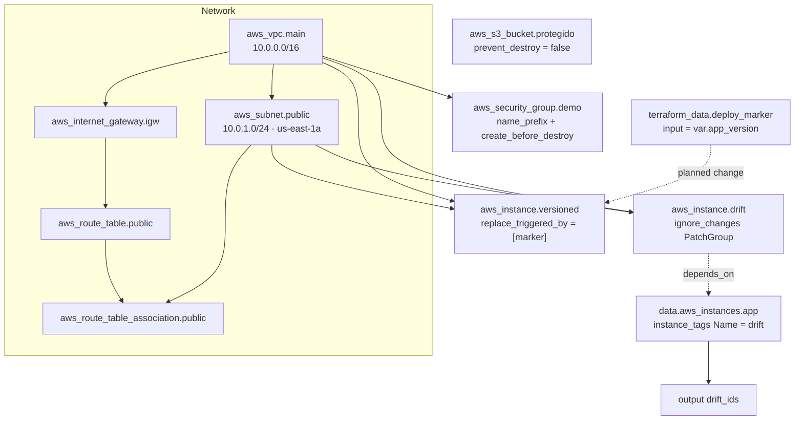

# Lab 11 — Lifecycle meta-arguments and explicit dependencies


This lab is a completed configuration. It builds a small VPC with one public subnet, an S3 bucket with a `prevent_destroy` guard, an unattached security group, two EC2 instances, a `terraform_data` marker, and an `aws_instances` data source that reads the drift instance after it is created. The four lifecycle rules are in `main.tf`, and the data source provides a real `depends_on` edge.

The point of the lab is not to memorize four block names. It is to read what Terraform plans when a replacement is forced, when a destroy is blocked, when drift is ignored, and when a data source has to wait for a resource that it does not reference. The guide explains the code, the provider-specific traps, and the experiments that make each behavior observable.

One detail matters before you start: the checked-in `prevent_destroy` is `false` so the lab can be destroyed after the experiment. Set it to `true` to reproduce the guard, then restore it to `false` before cleanup. The working copy also contains local state and a state backup from the practice run; they are ignored by Git and must not be published.

**In this guide:** [What this lab teaches](#what-this-lab-teaches) · [Architecture](#architecture) · [The configuration](#the-configuration) · [Lifecycle rules](#lifecycle-rules) · [Where `depends_on` fits](#where-depends_on-fits) · [Plan symbols](#reading-plan-symbols) · [Practice](#practice) · [Troubleshooting](#troubleshooting) · [Costs and safety](#costs-and-safety) · [Self-check](#check-your-understanding) · [Cleanup](#cleanup-and-reset)

## What this lab teaches

- Explain how `prevent_destroy` blocks a plan that would destroy a resource, and what it does not protect.
- Explain how `create_before_destroy` changes the replacement order and why `name_prefix` makes it work for a security group.
- Explain the difference between `ignore_changes = [tags]` and a narrow path such as `ignore_changes = [tags["PatchGroup"]]`.
- Explain why `replace_triggered_by` needs a managed resource such as `terraform_data` instead of a variable.
- Explain a real `depends_on` edge: an `aws_instances` data source that filters by a tag string and must wait for the instance.
- Read the plan symbols `+`, `~`, `-`, `-/+`, and `+/-` and connect them to the lifecycle rules.
- Recognize the force-new attributes of an AWS security group and the provider-specific behavior that makes an empty `dynamic` block different from an explicit purge.

## Architecture



The network is intentionally small: one VPC, one public subnet in `us-east-1a`, one internet gateway, one public route table, and one association. The two instances are in the public subnet and receive public IPs, but there is no key pair, no SSH ingress, and no application. They exist to demonstrate replacement and drift, not to serve traffic.

The security group is not attached to either instance. That is deliberate: `create_before_destroy` can create the new group while the old one still exists, and an attached group would add dependency edges that complicate the experiment. The S3 bucket is empty. The `terraform_data` resource is a marker, not an AWS resource; it stores `var.app_version` in state and gives the version a resource-like lifecycle. The `aws_instances` data source is the one explicit dependency in the graph: it filters by a tag string, not by a resource reference, so it needs `depends_on` to wait for the instance.

## The files in front of you

| Path | Role |
| --- | --- |
| `versions.tf` | Terraform and AWS provider constraints |
| `providers.tf` | AWS provider, fixed to `us-east-1` |
| `main.tf` | Data sources, network, bucket, security group, two instances, marker, outputs, and the lifecycle blocks |
| `.terraform.lock.hcl` | AWS 5.100.0 in this working copy |
| `terraform.tfstate`, `terraform.tfstate.backup` | Local artifacts from the practice run; ignored by Git and not published |

The lab keeps everything in `main.tf` because the lifecycle rules are local to the resources they modify. In a larger configuration, the network and the instances would be separate files or modules; the lifecycle block still belongs next to its resource.

## The configuration

The completed configuration creates ten resources and reads three data sources.

| Resource | Count | Purpose |
| --- | --- | --- |
| `aws_vpc.main` | 1 | Network container |
| `aws_subnet.public` | 1 | Public subnet in `us-east-1a` |
| `aws_internet_gateway.igw` | 1 | Internet path for the public subnet |
| `aws_route_table.public` | 1 | Default route to the gateway |
| `aws_route_table_association.public` | 1 | Associates the subnet with the route table |
| `aws_s3_bucket.protegido` | 1 | Bucket with the `prevent_destroy` guard |
| `aws_security_group.demo` | 1 | Unattached group with `create_before_destroy` |
| `aws_instance.drift` | 1 | Instance with a narrow `ignore_changes` path |
| `terraform_data.deploy_marker` | 1 | Version marker for `replace_triggered_by` |
| `aws_instance.versioned` | 1 | Instance replaced when the marker changes |

The three data sources are:

| Data source | What it reads | When it is read |
| --- | --- | --- |
| `aws_caller_identity.current` | Account ID for the bucket name | During plan |
| `aws_ami.al2023` | The most recent Amazon Linux 2023 x86_64 AMI | During plan |
| `aws_instances.app` | IDs of instances tagged `Name = tf-assoc-l11-drift` | After `aws_instance.drift` exists, because of `depends_on` |

From an empty state, the plan summary is:

```text
Plan: 10 to add, 0 to change, 0 to destroy.
```

The `aws_instances.app` read is deferred on the first run: the data source depends on the instance, so Terraform cannot know `drift_ids` until the instance has been created. The plan shows `drift_ids` as `(known after apply)`. After the apply, `terraform output drift_ids` returns a list with the drift instance ID. On later plans, the data source reads the existing instance and the value is known during plan.

The four outputs are:

| Output | Value |
| --- | --- |
| `protegido_bucket` | The protected bucket name |
| `drift_ip` | Public IP of the drift instance |
| `versioned_ip` | Public IP of the versioned instance |
| `drift_ids` | List of IDs returned by the `aws_instances` data source |

## Lifecycle rules

### `prevent_destroy`: the bucket guard

```hcl
resource "aws_s3_bucket" "protegido" {
  bucket = "tf-assoc-l11-protegido-${data.aws_caller_identity.current.account_id}"

  # Set to true to reproduce the guard; false keeps the lab destroyable.
  lifecycle {
    prevent_destroy = false
  }
}
```

The checked-in value is `false`. That is not an accident: after the practice run, the bucket must be destroyable, and a permanent `true` would block cleanup. Set it to `true` to reproduce the guard.

With `prevent_destroy = true`, Terraform rejects any plan that would destroy the bucket. `terraform plan -destroy` fails at plan time, and changing the bucket name also fails because the name is a force-new argument and the old bucket would have to be destroyed. The rule is a plan-time guard, not a backup: it is not recorded in state, so deleting the entire `aws_s3_bucket.protegido` block from the configuration will destroy the bucket on the next apply because the rule is no longer present. It also does not protect the bucket from manual deletion in the AWS console.

To test it safely, set the value to `true`, run `terraform apply` (it should report no changes), run `terraform plan -destroy`, and read the error. Then set it back to `false`, apply, and continue. The bucket remains empty, so a normal destroy succeeds once the guard is off.

### `create_before_destroy`: the security group with `name_prefix`

```hcl
resource "aws_security_group" "demo" {
  name_prefix = "tf-assoc-l11-demo-"
  description = "SG para probar create_before_destroy"
  vpc_id      = aws_vpc.main.id

  tags = {
    Name = "tf-assoc-l11-demo-sg"
  }

  ingress {
    from_port   = 80
    to_port     = 80
    protocol    = "tcp"
    cidr_blocks = ["0.0.0.0/0"]
  }

  egress {
    from_port   = 0
    to_port     = 0
    protocol    = "-1"
    cidr_blocks = ["0.0.0.0/0"]
  }

  lifecycle {
    create_before_destroy = true
  }
}
```

In AWS provider 5.x, `description`, `name`, `name_prefix`, and `vpc_id` are force-new attributes. A change to any of them replaces the security group. Tags are updateable. That distinction is the first thing to read in a plan: a `Name` tag change is an in-place update (`~`), while a `description` change is a replacement.

`name_prefix` is what makes `create_before_destroy` practical here. Terraform generates a unique name with the prefix, so the new group can coexist with the old one during the replacement. If the resource used a fixed `name`, the create would collide with the existing group and AWS would return `InvalidGroup.Duplicate`. The lesson's pattern is the same: use `name_prefix` when a security group must be replaced with `create_before_destroy`.

The group is unattached. If it were attached to an instance, the dependency graph would be more complex: Terraform propagates `create_before_destroy` to dependencies, and the instance would need to be updated or replaced in the right order. The lab keeps the group unattached so the replacement order is the only variable.

### `ignore_changes`: the drift instance and a narrow tag path

```hcl
resource "aws_instance" "drift" {
  ami           = data.aws_ami.al2023.id
  instance_type = "t3.micro"
  subnet_id     = aws_subnet.public.id

  tags = {
    Name        = "tf-assoc-l11-drift"
    Environment = "dev"
  }

  lifecycle {
    ignore_changes = [tags["PatchGroup"]]
  }
}
```

`ignore_changes = [tags["PatchGroup"]]` ignores only the `PatchGroup` key. It does not ignore `Name`, `Environment`, or a new `Project` tag. That narrow scope is deliberate: an external patch system can manage `PatchGroup` while Terraform continues to own the rest of the tag map.

The rule is evaluated when Terraform plans an update, not when it creates the resource. The initial create uses the configured tags. If you add an external `PatchGroup`, the plan reports no changes. If you add an external `Project`, the plan proposes to remove it, because only `PatchGroup` is ignored. If you remove the lifecycle rule, Terraform proposes to remove `PatchGroup` too. `ignore_changes` does not prevent drift; it hides one attribute from the plan. Use it for attributes that another process genuinely owns, and document that shared ownership.

### `replace_triggered_by`: the versioned instance and the marker

```hcl
resource "terraform_data" "deploy_marker" {
  input = var.app_version
}

resource "aws_instance" "versioned" {
  ami           = data.aws_ami.al2023.id
  instance_type = "t3.micro"
  subnet_id     = aws_subnet.public.id

  tags = { Name = "tf-assoc-l11-versioned" }

  lifecycle {
    replace_triggered_by = [terraform_data.deploy_marker]
  }
}
```

`terraform_data` is a built-in resource, not an AWS resource. It stores `var.app_version` in state. Changing the input plans an in-place update of the marker. The `replace_triggered_by` rule watches that planned action and forces a replacement of `aws_instance.versioned`, even though the instance's own `ami`, `instance_type`, and `subnet_id` are unchanged.

`replace_triggered_by` accepts managed resources or their attributes, not plain variables, locals, or data sources. That is why the marker exists: it gives the version a resource lifecycle. The marker is a declarative redeploy button, driven by a value in the repository. If you apply with `-var 'app_version=1.0.1'` and then apply without the flag, Terraform plans the marker back to `1.0.0` and replaces the instance again. Use the same input for the apply that you used for the plan.

### Force-new attributes and tags

The security group is the clearest example, but the rule applies more broadly: a force-new attribute is part of the object's identity, while a tag is metadata. When a plan shows `# forces replacement`, read which argument caused it. If the argument is a name, a description, a prefix, or a VPC ID, the object will be replaced. If the argument is a tag, the change is usually an in-place update. This is why the lab uses a tag for the in-place demonstration and a description or prefix change for the replacement.

## Where `depends_on` fits

Most dependencies in this lab are implicit. `aws_subnet.public` references `aws_vpc.main.id`, so Terraform knows the VPC must exist first. `aws_route_table.public` references `aws_internet_gateway.igw.id` in its route, so the gateway comes first. `aws_route_table_association.public` references both the subnet and the route table. `aws_instance.drift` and `aws_instance.versioned` reference the subnet and the AMI data source. No `depends_on` is needed for any of those edges.

The explicit dependency is the data source:

```hcl
data "aws_instances" "app" {
  instance_tags = { Name = "tf-assoc-l11-drift" }

  # The tag filter is a string, not a reference; wait for the instance.
  depends_on = [aws_instance.drift]
}

output "drift_ids" {
  value = data.aws_instances.app.ids
}
```

The filter is a string, not a reference to `aws_instance.drift`, so Terraform cannot infer an edge from the configuration. Without `depends_on`, the data source could be read during the first plan, before the instance exists, and return an empty list. With `depends_on`, the read waits until the instance has been created. The data source does not receive values from the instance; it returns the IDs that match the tag. This is a read-after-write dependency, not a value dependency.

On the first apply, the read is deferred and `drift_ids` is unknown until apply. On later plans, the data source reads the existing instance and the value is known during plan. `depends_on` can also make dependent values unknown until apply, which is why it belongs on a data source that genuinely needs the resource to exist, not on every resource in the configuration.

`depends_on` is not a replacement trigger. It adds an ordering edge; it does not pass values and does not force a replacement by itself. A change in the dependency can still contribute indirectly to a replacement that is planned for other reasons. The exam trap is the opposite claim: Terraform does not require `depends_on` for every dependency. It manages most dependencies automatically from references; `depends_on` is for the cases where no reference exists.

## Reading plan symbols

Terraform's plan uses symbols to summarize the action for each resource. The exact legend can vary by version, but the core meanings are stable:

| Symbol | Action | What it means |
| --- | --- | --- |
| `+` | Create | The object does not exist in state |
| `~` | Update in place | Terraform will change attributes without replacing the object |
| `-` | Destroy | The object will be removed |
| `-/+` | Replace, destroy then create | The default replacement order |
| `+/-` | Replace, create then destroy | The order produced by `create_before_destroy` |

The last two are the ones to watch in the security group exercise. A replacement is still a replacement; the difference is the order. `create_before_destroy` does not avoid the replacement, it changes which side of the replacement happens first. That matters when the old object must remain available while the new one is being created.

## Prerequisites and safety

- Terraform **1.12.0** or newer. The configuration's `required_version` is `>= 1.12.0`.
- AWS credentials with permissions for VPC, subnet, internet gateway, route table, S3, security group, EC2, and the `aws_instances` data source. The plan reads `aws_caller_identity`, `aws_ami`, and the data source, so credentials are required before the first plan.
- AWS CLI v2 configured with the same credentials. The `ignore_changes` and cleanup experiments use `aws ec2` and `aws s3`; Terraform alone is not enough for those steps.
- The provider region is fixed to `us-east-1`, and the subnet is pinned to `us-east-1a`. The AMI filter is Amazon Linux 2023 x86_64.
- Applying creates ten resources: one VPC, one subnet, one gateway, one route table, one association, one S3 bucket, one security group, two `t3.micro` instances, and one `terraform_data`. The instances have EBS root volumes and public IPv4 addresses. There is no NAT gateway.
- The bucket is empty. If you upload objects outside Terraform, `terraform destroy` will fail on the non-empty bucket until you empty it.
- The instances have no key pair, no SSH ingress, and no application. They are replacement and drift subjects, not a working service.
- `prevent_destroy` is `false` in the checkout so cleanup works. Set it to `true` only for the guard experiment, and restore it to `false` before destroying.
- `create_before_destroy` can temporarily create a second security group. The lab's group is unattached, so the old group can be destroyed cleanly.
- `ignore_changes` hides drift by design. It ignores only `PatchGroup` in this lab; other tag changes are still detected.
- `replace_triggered_by` can replace a running instance. Expect the public IP to change and the old instance to be destroyed.
- `depends_on` on the data source is intentional. Removing it can make the data source read before the instance exists.
- Do not commit state, plan files, credentials, or `.terraform/`. The lock file is safe to commit.

## Practice

The experiments assume the completed configuration in `labs/w02/lab11-lifecycle`. If you are studying with a tutor, show the actual command output; the plan symbols and state addresses are the evidence.

### Experiment 1 — Baseline and the deferred data source

**Objective:** Confirm that the configuration initializes, validates, plans ten resources, and defers the `aws_instances` read until apply.

**Steps:**

```sh
terraform init
terraform state list
terraform fmt -check
terraform validate
terraform plan
```

Then apply and inspect the outputs:

```sh
terraform apply
terraform output drift_ids
terraform output protegido_bucket
```

**Expected result:** `init` installs AWS 5.100.0 or reports it as previously installed. `state list` prints nothing if the checkout is empty; if it lists resources from an earlier run, destroy them or work in a scratch copy before expecting the ten-resource count. `fmt -check` prints nothing. `validate` reports `Success! The configuration is valid.` The plan ends with `Plan: 10 to add, 0 to change, 0 to destroy.` and shows `drift_ids` as `(known after apply)` because the data source depends on `aws_instance.drift`. After apply, `terraform output drift_ids` returns a list with one instance ID.

**Solution:** The data source has no reference to the instance, only a tag string, so `depends_on` is the edge that makes Terraform wait. The read is deferred to apply; that is why the output is unknown at first plan. The bucket name includes the account ID, so it differs by account.

**Criteria:** You can explain why `drift_ids` is unknown at plan time and known after apply, and why the data source is not counted in the ten-resource plan summary.

### Experiment 2 — `prevent_destroy`

**Objective:** Make Terraform refuse a plan that would destroy the bucket, then restore the destroyable state.

**Steps:**

1. Set `prevent_destroy = true` in the bucket's `lifecycle` block.
2. Run `terraform apply` (it should report no changes if the bucket already exists).
3. Run `terraform plan -destroy` and read the error. Do not run `terraform destroy`.
4. Change the bucket name (for example, add a suffix) and run `terraform plan`. Read the error.
5. Restore the original name and set `prevent_destroy = false`.
6. Run `terraform apply` and then `terraform destroy` when you are ready to clean up.

**Expected result:** `terraform plan -destroy` fails at plan time with an error that names `aws_s3_bucket.protegido` and says the instance cannot be destroyed. The bucket rename also fails, because changing the bucket name is a force-new change and the old bucket would have to be destroyed. After you set the value back to `false`, `apply` succeeds and `destroy` can proceed. No bucket is deleted while the guard is active.

**Solution:** `prevent_destroy` is a plan-time guard. Terraform evaluates it before calling AWS, so the destroy never reaches the bucket. The rule is not a state-level lock: if you delete the entire `aws_s3_bucket.protegido` block from the configuration, Terraform will destroy the bucket during the next apply because the lifecycle rule is no longer present. That is the exam trap. To remove protection safely, set the value to `false`, apply, then destroy — or remove the resource from state only if you intend to manage it elsewhere.

**Criteria:** You can explain why the destroy fails before any AWS delete call, why a name change is also blocked, and why deleting the resource block is different from setting `prevent_destroy` to `false`.

### Experiment 3 — `create_before_destroy`

**Objective:** Reverse the replacement order for the security group and read the plan symbol.

**Steps:**

1. Confirm the security group has `create_before_destroy = true` and `name_prefix = "tf-assoc-l11-demo-"`.
2. Run `terraform apply`.
3. Change the group's `Name` tag (for example, to `tf-assoc-l11-demo-sg-v2`) and run `terraform plan`. Read the symbol.
4. Apply the tag change.
5. Change the group's `description` (for example, append `-v2`) and run `terraform plan`. Read the symbol and the order of the two operations.
6. Apply the description change and observe that the new group is created before the old one is destroyed.
7. For comparison, remove `create_before_destroy`, change the description back, and run `terraform plan` again. Read the symbol. Do not apply the comparison unless you are comfortable with the destroy-first order; the group is unattached, so there is no traffic impact.

**Expected result:** The `Name` tag change is an in-place update (`~`); it does not replace the group. The `description` change is a replacement. With `create_before_destroy`, the plan shows the create-before-destroy order (`+/-` in current Terraform) and the new group is created while the old one still exists. Without the rule, the plan shows the default destroy-then-create order (`-/+`). The apply succeeds because `name_prefix` generates a unique name for the new group and the group is not attached.

**Solution:** In AWS provider 5.x, `description`, `name`, `name_prefix`, and `vpc_id` are force-new attributes; tags are updateable. A fixed `name` plus `create_before_destroy` can fail with `InvalidGroup.Duplicate` if the new group tries to use the same name while the old group still exists. `name_prefix` avoids that collision. `create_before_destroy` is opt-in because many resources have unique-name or capacity constraints that make concurrent old and new objects impossible.

**Criteria:** You can read the plan legend and explain why `+/-` is not "no replacement"; it is the same replacement with the opposite order. You can also explain why `name_prefix` is necessary for this security group and why `description` is a force-new attribute.

### Experiment 4 — `ignore_changes`

**Objective:** Let an external process manage the `PatchGroup` tag without Terraform trying to remove it, then observe the narrow scope of the rule.

**Steps:**

1. Confirm the drift instance has `ignore_changes = [tags["PatchGroup"]]`.
2. Run `terraform apply`.
3. Find the instance ID from state and add an external `PatchGroup` tag:

```sh
INSTANCE_ID=$(terraform state show -no-color aws_instance.drift \
  | awk '$1 == "id" { gsub(/"/, "", $3); print $3; exit }')

aws ec2 create-tags \
  --region us-east-1 \
  --resources "$INSTANCE_ID" \
  --tags Key=PatchGroup,Value=prod
```

4. Run `terraform plan` and `terraform apply`. Read the result.
5. Add an external `Project` tag and run `terraform plan` again. Read the proposed change.
6. Remove the `ignore_changes` rule and run `terraform plan` again. Read the proposed change.
7. Apply the change and confirm that Terraform removes the external tags.

**Expected result:** With `ignore_changes = [tags["PatchGroup"]]`, the plan reports no changes for the `PatchGroup` tag. The external `Project` tag is still detected, because only `PatchGroup` is ignored; the plan proposes to remove `Project`. After you remove the lifecycle rule, the plan proposes to remove `PatchGroup` too. The instance is not replaced.

**Solution:** `ignore_changes` is evaluated when Terraform plans an update, not when it creates the resource. The initial create still uses the configured tags. The rule tells Terraform to share management of one attribute with an external process. `ignore_changes = [tags]` ignores the whole map; `ignore_changes = [tags["PatchGroup"]]` ignores only that key and still detects changes to other tags. Neither form prevents drift; it only hides the attribute from the plan. Use it for tags managed by a patch agent, a cost tool, or another controller, and document the shared ownership.

**Criteria:** You can explain why the plan says "No changes" for `PatchGroup` while it still removes `Project`, what happens when the rule is removed, and why `ignore_changes` is not a substitute for fixing an unwanted drift.

### Experiment 5 — `replace_triggered_by`

**Objective:** Turn `var.app_version` into a redeploy button that replaces the versioned instance without changing any of its own arguments.

**Steps:**

1. Confirm `aws_instance.versioned` has `replace_triggered_by = [terraform_data.deploy_marker]`.
2. Run `terraform plan` with the default `app_version = "1.0.0"` and confirm there are no changes.
3. Run `terraform plan -var 'app_version=1.0.1'`. Read the plan for `terraform_data.deploy_marker` and for `aws_instance.versioned`.
4. Apply the change with the same `-var 'app_version=1.0.1'`; if you omit it, Terraform plans back to `1.0.0`. Note the new public IP.
5. Change the version back to `1.0.0` and plan again. The instance should be replaced again.

**Expected result:** `terraform_data.deploy_marker` is updated in place when `app_version` changes. `aws_instance.versioned` must be replaced, with a note such as `(because terraform_data.deploy_marker changed)`. The instance's `ami`, `instance_type`, and `subnet_id` do not change; the replacement is triggered by the marker. The public IP changes after the apply.

**Solution:** `replace_triggered_by` accepts references to managed resources or their attributes, not plain variables, locals, or data sources. `terraform_data` gives the version a resource lifecycle: its `input` is stored in state, and changing the input plans an action. The lifecycle rule watches that action and forces the instance replacement. `depends_on` would only order the operations; it would not replace anything by itself. It can defer reads or make values unknown, and a change in the dependency can contribute indirectly to a replacement that is planned for other reasons. The marker is the declarative equivalent of a deliberate `-replace`, driven by a value in the repository.

**Criteria:** You can explain why referencing `var.app_version` directly is invalid, why `terraform_data` is counted as a resource, and why the instance is replaced even though none of its own arguments changed.

### Experiment 6 — `depends_on` and deferred reads

**Objective:** See the explicit edge between the `aws_instances` data source and the drift instance, and observe what happens without it.

**Steps:**

```sh
terraform output drift_ids
terraform graph | grep -E 'aws_instances|aws_instance.drift'
```

If you have Graphviz installed, render the graph:

```sh
terraform graph | dot -Tsvg > graph.svg
```

For the comparison, make a scratch copy of the configuration, remove `depends_on = [aws_instance.drift]` from the data source, and run `terraform plan` against an empty state. Do not modify the real lab.

**Expected result:** The output contains the drift instance ID. The graph shows an edge from `data.aws_instances.app` to `aws_instance.drift`. With the real configuration, the first plan defers the data source read and `drift_ids` is unknown until apply. In the scratch copy without `depends_on`, the data source has no reference to the instance and may be read during plan before the instance exists, returning an empty list. Restore the real configuration after the comparison.

**Solution:** The `instance_tags` filter is a string, not a reference, so Terraform cannot infer the edge. `depends_on` adds the ordering edge; it does not pass values. The data source returns the IDs that match the tag. `depends_on` can defer reads and make values unknown until apply, which is the correct trade-off when the data source genuinely needs the resource to exist. It is not a replacement trigger.

**Criteria:** You can explain why the data source needs `depends_on`, why the output is unknown at first plan, and what would happen if the data source read before the instance existed.

### Experiment 7 — Clean up

**Objective:** Return the account to its previous state and verify that nothing billable remains.

**Steps:**

1. Set `prevent_destroy = false` if you enabled it for Experiment 2.
2. Capture the bucket name before the destroy, because the output disappears with the state:

```sh
BUCKET=$(terraform output -raw protegido_bucket)
terraform destroy
terraform state list
```

3. If the destroy fails with `BucketNotEmpty`, the state still exists; empty the bucket and retry:

```sh
aws s3 rm "s3://$BUCKET" --recursive
terraform destroy
```

4. If `create_before_destroy` left an old security group, check the VPC in the AWS console; the destroy should remove both the current and the old group if Terraform still tracks them.
5. Remove any `terraform.tfvars` created for an experiment.

**Expected result:** The destroy removes the ten managed resources. `terraform state list` prints nothing. The S3 bucket, instances, VPC, subnet, gateway, route table, security group, and `terraform_data` are gone. If the destroy fails on a bucket, the error names the bucket and the remaining objects.

**Solution:** Terraform destroys the S3 objects before the bucket because the objects depend on the bucket. An object uploaded outside Terraform is not in that graph, so the bucket deletion fails until you remove it. `--recursive` removes every object in the bucket, including managed objects that remain in state; use it only when you intend to clean the bucket completely.

**Criteria:** You can explain why `terraform destroy` is not the same as deleting the state file, why the bucket name must be captured before the destroy, and why an unmanaged object blocks the bucket deletion.

## Expected results at a glance

| Action | What success looks like | What it proves |
| --- | --- | --- |
| `terraform plan` from an empty state | `Plan: 10 to add`; `drift_ids` unknown | The resource count is complete and the data source is deferred |
| `terraform apply` | Ten resources created | The network, instances, bucket, group, and marker exist |
| `terraform output drift_ids` | A list with the drift instance ID | The `aws_instances` data source read after the instance |
| `prevent_destroy = true` + `terraform plan -destroy` | Plan aborts; bucket remains | The guard is evaluated before AWS |
| Bucket rename with `prevent_destroy = true` | Plan aborts with a force-new error | The guard also blocks replacements |
| `create_before_destroy` + description change | `+/-` order; new group created first | The replacement order changed |
| `ignore_changes = [tags["PatchGroup"]]` + external `PatchGroup` | `No changes` for that tag | The narrow path is ignored |
| External `Project` tag | Plan proposes to remove it | The rule does not ignore the whole map |
| `replace_triggered_by` + version change | Instance replaced with a `(because ... changed)` note | The marker drives the replacement |
| `depends_on` on the data source | `drift_ids` known after apply | The read waits for the instance |
| `terraform destroy` | Ten resources destroyed | Cleanup is part of the workflow |

## Troubleshooting

| Symptom | Likely cause | What to do |
| --- | --- | --- |
| `Error: Instance cannot be destroyed` | `prevent_destroy` is `true` and the plan would destroy the bucket | Set it to `false`, apply, then destroy. Do not use `state rm` to bypass it. |
| The bucket rename fails with a force-new error | `prevent_destroy` also blocks replacements | Restore the old name or set the guard to `false` deliberately. |
| `InvalidGroup.Duplicate` with `create_before_destroy` | The new group uses a fixed `name` while the old group exists | Use `name_prefix`, as the lab does. |
| `ignore_changes` has no effect on `Project` | The rule ignores only `tags["PatchGroup"]` | That is the intended narrow scope; use `[tags]` only if you really want to ignore the whole map. |
| The external tag is not ignored on create | `ignore_changes` applies to updates, not creates | The initial create uses the configured tags; the rule affects later plans. |
| `Invalid expression in replace_triggered_by` | You referenced a variable, local, or data source | Reference a managed resource such as `terraform_data.deploy_marker`. |
| The marker changes but the instance is not replaced | The lifecycle rule is missing or references the wrong resource | Check the `replace_triggered_by` list and the plan note. |
| `drift_ids` is empty | The data source read before the instance, or the tag does not match | Check `depends_on` and the `Name = tf-assoc-l11-drift` tag. |
| `Cycle: ...` after adding `depends_on` | The explicit edge creates a loop with an existing reference | Remove the redundant `depends_on`; the reference already orders the resources. |
| `BucketNotEmpty` during destroy | The bucket contains objects Terraform does not manage | Empty it with `aws s3 rm --recursive`, then destroy. |
| `InvalidAMIID.NotFound` | The AMI filter found no image in the region | Check `data.aws_ami.al2023` and the provider region. |
| `UnauthorizedOperation` | The credentials lack an EC2, S3, or VPC permission | Check the IAM policy; do not broaden it blindly. |

## Costs and safety

The lab creates two `t3.micro` instances, their EBS root volumes, two public IPv4 addresses, and one empty S3 bucket. There is no NAT gateway. The instances run until you destroy them; the bucket is empty, so its storage cost is negligible. Check current AWS pricing for your region rather than relying on a number from a guide.

The lifecycle rules change the safety profile:

- `prevent_destroy` is a guard, not a backup. It blocks Terraform plans while the rule is `true`, but it does not protect the bucket from manual deletion in the AWS console, and it does not survive the removal of the resource block. The checked-in value is `false` so cleanup works; set it to `true` only for the experiment.
- `create_before_destroy` can temporarily double the security group. The lab's group is unattached, so there is no traffic impact. If you apply the rule to an attached resource, expect a short period with both old and new objects and read the dependency order.
- `ignore_changes` hides drift. The lab ignores only `PatchGroup`; remove the rule after the exercise if you want Terraform to manage the full tag map again.
- `replace_triggered_by` destroys and recreates a running instance. Expect the public IP to change and any local state on the instance to be lost. The lab has no application, so the impact is limited to the instance lifecycle.
- `depends_on` on the data source is intentional. Removing it can make `drift_ids` empty or unknown at the wrong time.
- The instances have no SSH ingress and no key pair. Do not add one just to inspect them; use the plan and the AWS console, or add temporary access and remove it.
- State and plan files can contain resource attributes. Do not commit them. The repository's `.gitignore` excludes `*.tfstate`, `*.tfstate.*`, `.terraform/`, `*.tfvars`, and `tfplan`; the lock file is safe to commit.

## Check your understanding

1. What does `prevent_destroy` block, and what does it not block?
2. What is the plan symbol for a replacement with `create_before_destroy`, and how does it differ from the default?
3. Which security group attributes are force-new, and which are updateable?
4. What is the difference between `ignore_changes = [tags]` and `ignore_changes = [tags["PatchGroup"]]`?
5. Does `ignore_changes` prevent a tag from being created on the first apply?
6. Why does `replace_triggered_by` need `terraform_data` instead of `var.app_version`?
7. What does `depends_on` do on the `aws_instances` data source? Does it cause a replacement?
8. Are most dependencies in this lab implicit or explicit? What about the data source?

**Answers:**

1. It blocks plans that would destroy the resource while the rule is `true`, including replacements caused by a force-new change. It does not prevent destruction if you remove the resource block from the configuration, and it does not protect against manual deletion outside Terraform.
2. `create_before_destroy` produces the create-then-destroy order, shown as `+/-` in current Terraform. The default replacement order is destroy-then-create, shown as `-/+`. The replacement still happens; only the order changes.
3. `description`, `name`, `name_prefix`, and `vpc_id` are force-new. Tags are updateable. The lab uses `name_prefix` so the new group can coexist with the old one.
4. `[tags]` ignores the whole tag map. `[tags["PatchGroup"]]` ignores only the `PatchGroup` key and still detects changes to other tags such as `Project`.
5. No. `ignore_changes` affects update planning; the initial create uses the configured tags.
6. `replace_triggered_by` only accepts managed resources or their attributes. A variable is a plain value with no planned action. `terraform_data` gives the variable a resource lifecycle, so a change to its input becomes a planned action that can trigger the replacement.
7. It orders the data source read after `aws_instance.drift`, because the tag filter is a string rather than a reference. It does not pass values and does not force a replacement by itself; it can defer reads or make values unknown, and a change in the dependency can contribute indirectly to a replacement planned for other reasons.
8. Almost all of them are implicit, created by references such as `vpc_id = aws_vpc.main.id` or `subnet_id = aws_subnet.public.id`. The `aws_instances` data source is the explicit exception: it uses `depends_on` because its tag filter does not reference the instance.

## Cleanup and reset

Set `prevent_destroy = false` if you enabled it for the experiment. Capture the bucket name before the destroy, because the output disappears with the state:

```sh
BUCKET=$(terraform output -raw protegido_bucket)
terraform destroy
```

If the destroy fails with `BucketNotEmpty`, the state still exists; empty the bucket and retry:

```sh
aws s3 rm "s3://$BUCKET" --recursive
terraform destroy
```

Check `terraform state list`; it should print nothing. If `create_before_destroy` left an old security group, check the VPC in the AWS console; the destroy should remove both the current and the old group if Terraform still tracks them. Remove any `terraform.tfvars` created for an experiment. Do not delete the state file to "reset" the lab; destroy the resources first.

The verification run created `.terraform.lock.hcl` with AWS 5.100.0. Keep it: it records the provider selection and hashes. Do not commit state or plan files.

## What's next

Lesson 12 moves from lifecycle to validation and sensitive data: custom `validation` blocks, `sensitive = true`, ephemeral values, and write-only arguments. The state and backend lessons then explain where the state that these lifecycle rules act on actually lives. The `terraform_data` marker and the `replace_triggered_by` pattern are useful later when a module needs a deliberate redeploy trigger without changing the resource's own arguments; the `aws_instances` data source is a small example of a read-after-write dependency that `depends_on` makes explicit.

## References

- Terraform lifecycle: [`lifecycle` reference](https://developer.hashicorp.com/terraform/language/meta-arguments/lifecycle).
- Terraform dependencies: [`depends_on` reference](https://developer.hashicorp.com/terraform/language/meta-arguments/depends_on).
- Built-in resource: [`terraform_data`](https://developer.hashicorp.com/terraform/language/resources/terraform-data).
- Plan output: [understand plan output](https://developer.hashicorp.com/terraform/cli/commands/plan#understand-plan-output).
- AWS provider: [`aws_security_group`](https://registry.terraform.io/providers/hashicorp/aws/latest/docs/resources/security_group), [`aws_s3_bucket`](https://registry.terraform.io/providers/hashicorp/aws/latest/docs/resources/s3_bucket), [`aws_instance`](https://registry.terraform.io/providers/hashicorp/aws/latest/docs/resources/instance), [`aws_instances` data source](https://registry.terraform.io/providers/hashicorp/aws/latest/docs/data-sources/instances).

## Verification

This guide is based on static inspection of `versions.tf`, `providers.tf`, `main.tf`, and `.terraform.lock.hcl`. `terraform fmt -check -diff -recursive` passes for this directory. `terraform init` created `.terraform.lock.hcl` with AWS 5.100.0. The configuration was formatted, but `terraform validate` was not used as a completion criterion for this guide, and `terraform plan`, `apply`, or `destroy` were not executed while writing it. The working copy contains local state and a state backup from the practice run; they were not read and are not published. No AWS account was touched while writing this guide. The checked-in `prevent_destroy = false` is intentional so the lab remains destroyable; set it to `true` only for the guard experiment. Exact plan symbols, error wording, and resource counts can vary by Terraform and provider version.
