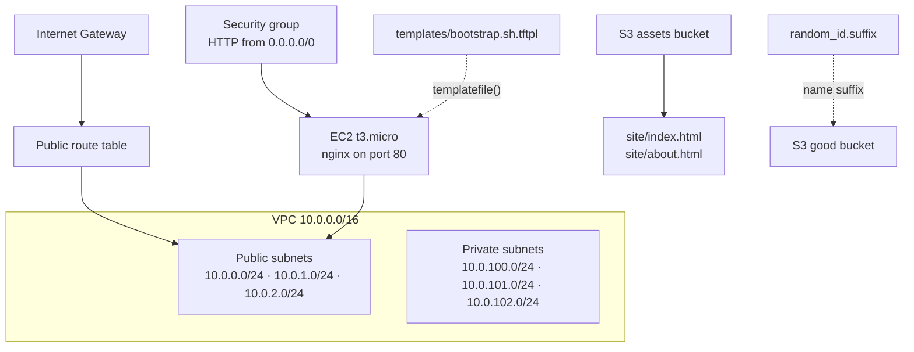

# Lab 9 — Functions, templates, and a computed network


The first labs wrote values by hand: a CIDR here, a bucket name there, a script copied into `user_data`. This lab starts computing them. One input CIDR produces six subnets, an AMI lookup selects the image, a template renders the bootstrap script, and a `fileset` decides which HTML files become S3 objects. The goal is not to memorize a list of functions. It is to recognize the places where a function makes the configuration shorter, more consistent, and easier to change without breaking the graph.

The configuration builds a VPC with three public and three private `/24` subnets, an internet gateway and a public route table, one EC2 instance running nginx, and two S3 buckets. A small two-page site is uploaded to the assets bucket. The private subnets are deliberately isolated: there is no NAT gateway, no private route table, and no outbound path. That keeps the lab cheap and makes the network diagram honest.

**In this guide:** [What this lab teaches](#what-this-lab-teaches) · [Architecture](#architecture) · [The files](#the-files-in-front-of-you) · [Reading the configuration](#reading-the-configuration) · [Practice](#practice) · [Troubleshooting](#troubleshooting) · [Costs and safety](#costs-and-safety) · [Self-check](#check-your-understanding) · [Cleanup](#cleanup-and-reset)

## What this lab teaches

- Use `cidrsubnet`, `cidrhost`, and `cidrnetmask` to derive addresses instead of typing them.
- Use `slice`, `length`, `range`, `element`, `format`, and `merge` to shape values for resources and tags.
- Read a `templatefile` call: variables, loops, conditionals, and the `~` whitespace marker.
- Distinguish `file()` from `templatefile()` and know when each one is appropriate.
- Use `fileset` and `filemd5` to make S3 objects follow the files in the repository.
- Explain why `random_id` is a managed resource and why `uuid()` would not be a stable substitute.
- Predict how changing `vpc_cidr`, `subnet_count`, or `environment` changes the plan.

## Architecture



The diagram is intentionally asymmetric. The public subnets have a route to the internet gateway; the private subnets have no route table association beyond the VPC's main route table, so they can reach other VPC addresses but not the internet. The security group is attached to the instance, and the instance is in the first public subnet. The S3 bucket is not a web server: its objects are private by default, and the nginx page is served by the instance, not by S3.

| Built | Count | Notes |
| --- | --- | --- |
| VPC | 1 | `10.0.0.0/16`, DNS hostnames enabled |
| Public subnets | 3 | One per AZ selected by `slice` |
| Private subnets | 3 | No NAT gateway and no public route |
| Internet gateway | 1 | Attached to the VPC |
| Public route table | 1 | `0.0.0.0/0` to the gateway |
| Route table associations | 3 | One per public subnet |
| Security group | 1 | HTTP/80 from anywhere; all egress |
| EC2 instance | 1 | Amazon Linux 2023, `t3.micro`, nginx |
| S3 buckets | 2 | `assets` with the site; `good` with a random suffix |
| `random_id` | 1 | Eight hex characters, stored in state |
| S3 objects | 2 | `site/index.html` and `site/about.html` |

From an empty state, the plan proposes **19 resources** and reads **4 data sources**. The number is useful for checking that you are in the right directory and that no resource was accidentally added or removed.

## The files in front of you

| Path | Role |
| --- | --- |
| `versions.tf` | Terraform and provider constraints |
| `providers.tf` | AWS provider, fixed to `us-east-1` |
| `variables.tf` | `vpc_cidr`, `subnet_count`, `environment` |
| `locals.tf` | AZ data source, subnet CIDRs, tags, derived names |
| `main.tf` | Data sources and all managed resources except the AZ lookup |
| `outputs.tf` | Network summary, instance IP, bucket name |
| `templates/bootstrap.sh.tftpl` | Rendered user data with loops and a conditional |
| `scripts/userdata.sh` | A raw script kept for comparison; **not referenced** |
| `site/index.html`, `site/about.html` | Files uploaded by `fileset` |
| `.terraform.lock.hcl` | AWS 5.100.0 and random 3.9.1 in this working copy |

The split into `versions.tf`, `providers.tf`, `variables.tf`, `locals.tf`, `main.tf`, and `outputs.tf` is the layout the course uses for readability. A single file would work; the separation makes the data flow easier to follow.

## Reading the configuration

### Inputs

| Input | Type | Default | What it controls |
| --- | --- | --- | --- |
| `vpc_cidr` | `string` | `"10.0.0.0/16"` | Base network; all subnets are derived from it |
| `subnet_count` | `number` | `3` | Number of public and private subnets |
| `environment` | `string` | `"dev"` | Name prefix, tags, and the monitoring branch |

`subnet_count` is not a free-form capacity knob. The code slices the first `subnet_count` Availability Zones, creates one public and one private subnet per AZ, and indexes the first public subnet when it configures the instance. Values below 1 break the instance reference; values above the number of AZs break the slice. In `us-east-1`, the data source usually returns six AZs, so 1–6 is the safe range for this lab.

`environment` is not an environment separator. It is part of `local.name_prefix`, which feeds bucket names, security group names, and tags. Changing it changes the **same** resources in the same state. There is no second VPC, no second state, and no parallel environment. The plan will show replacements for names that are force-new, and updates for tags that are not.

### The network math

The core of the lab is a small block of locals:

```hcl
locals {
  azs             = slice(data.aws_availability_zones.available.names, 0, var.subnet_count)
  public_subnets  = [for i in range(var.subnet_count) : cidrsubnet(var.vpc_cidr, 8, i)]
  private_subnets = [for i in range(var.subnet_count) : cidrsubnet(var.vpc_cidr, 8, i + 100)]
  total_subnets   = length(local.public_subnets) + length(local.private_subnets)
  netmask         = cidrnetmask(var.vpc_cidr)
  is_production   = var.environment == "prod"
  name_prefix     = "tf-assoc-l9-${var.environment}"
  common_tags     = merge(
    {
      Project     = "tf-assoc"
      Environment = var.environment
      ManagedBy   = "terraform"
      Lesson      = "L9"
    },
    local.is_production ? {
      Backup = "required"
      Tier   = "critical"
      } : {
      Backup = "none"
    }
  )
}
```

`cidrsubnet(prefix, newbits, netnum)` extends the prefix by `newbits` and selects the `netnum`-th subnet. With `10.0.0.0/16`, `newbits = 8` produces a `/24`, and `netnum = 2` selects the third `/24`. The public list uses `0, 1, 2`; the private list uses `100, 101, 102`, which keeps the two ranges far apart and makes the diagram easy to read. `range(var.subnet_count)` produces the indices `0..n-1`; the `for` expression turns each index into a CIDR string.

`cidrnetmask` converts the prefix length into a dotted-decimal mask: `/16` becomes `255.255.0.0`. `length` counts the resulting list elements. `slice(list, 0, n)` takes the first `n` AZ names; the end index is exclusive. `element(list, index)` returns one element and wraps around when the index is larger than the list, which is why the code uses `slice` first and then indexes with `count.index` instead of relying on the wrapping behavior.

`format("%s-public-%02d", local.name_prefix, count.index + 1)` produces names such as `tf-assoc-l9-dev-public-01`. The `%02d` pads the number to two digits, so lexical order matches numeric order. `merge` combines maps; later arguments win. That is why a resource can merge `local.common_tags` with a `Name` and a `Tier` and override the production `Tier = "critical"` for a subnet that is explicitly public or private.

The computed values for the defaults are:

| Expression | Result |
| --- | --- |
| `local.public_subnets[0]` | `10.0.0.0/24` |
| `local.public_subnets[1]` | `10.0.1.0/24` |
| `local.public_subnets[2]` | `10.0.2.0/24` |
| `local.private_subnets[0]` | `10.0.100.0/24` |
| `local.private_subnets[1]` | `10.0.101.0/24` |
| `local.private_subnets[2]` | `10.0.102.0/24` |
| `local.netmask` | `255.255.0.0` |
| `local.total_subnets` | `6` |

Changing `vpc_cidr` is not a tag update. Every `cidrsubnet` result changes, the subnets are replaced, and the instance is replaced because its subnet ID changes. Keep the prefix large enough for the 8 newbits used here; a `/24` input with `newbits = 8` would produce `/32` subnets, which AWS does not accept.

One AWS detail matters here. AWS reserves the first four addresses and the last address of every subnet. In `10.0.0.0/24`, `10.0.0.1` is the VPC router, `10.0.0.2` is the DNS address, `10.0.0.3` is reserved for future use, and `10.0.0.255` is the broadcast address. The first address available to an instance is `10.0.0.4`. The output calls `cidrhost(local.public_subnets[0], 2)` `primer_host_dns`, which is accurate as a DNS address but not as the first usable host. The function computes the address; AWS decides which addresses are reserved.

### Data sources

Four data sources feed the configuration:

| Data source | What it reads | Why it matters |
| --- | --- | --- |
| `aws_availability_zones.available` | AZ names in the current region | The subnets are spread across real AZs |
| `aws_caller_identity.current` | Account ID | The assets bucket name includes it to reduce collisions |
| `aws_ami.al2023` | The most recent Amazon Linux 2023 x86_64 AMI | The instance does not hardcode an AMI ID |
| `aws_region.current` | The provider's region name | The template receives the region as a variable |

All four are read during `plan`. That is why this lab needs AWS credentials even for a plan: the AZ list, the AMI lookup, and the caller identity are API calls, not local calculations. The region data source reads provider metadata; the other three are the ones that need AWS. The provider region is fixed in `providers.tf`, so `data.aws_region.current.name` is `us-east-1` in this checkout.

### Resources

The resources follow the network path:

- `aws_vpc.main` owns `10.0.0.0/16` and enables DNS hostnames.
- `aws_subnet.public` uses `count = length(local.public_subnets)`, indexes the CIDR list with `count.index`, and selects the AZ with `element(local.azs, count.index)`. Public subnets map public IPs on launch.
- `aws_subnet.private` uses the same pattern with the private CIDR list. It does **not** map public IPs and is not associated with the public route table.
- `aws_internet_gateway.igw` attaches to the VPC. `aws_route_table.public` sends `0.0.0.0/0` to the gateway. `aws_route_table_association.public` associates each public subnet with that route table.
- `aws_security_group.web` allows TCP/80 from `0.0.0.0/0` and all egress. It is attached to the instance.
- `aws_instance.web` uses the first public subnet, the AMI data source, `t3.micro`, and the rendered template. `user_data_replace_on_change = true` turns a change in the rendered script into a replacement rather than a stop/start update.
- `aws_s3_bucket.assets` holds the site. Its name is `${local.name_prefix}-assets-${account_id}`. `aws_s3_object.site` uses `for_each = fileset("${path.module}/site", "**/*.html")` and uploads each file with `source`, `etag = filemd5(...)`, and `content_type = "text/html"`.
- `random_id.suffix` creates an eight-character hex suffix. `aws_s3_bucket.good` uses it in its name. That bucket is not referenced anywhere else; it exists to show a stable random suffix and to make the dependency visible in the graph.
- `aws_s3_bucket.good` has no tags and no objects. It is still a managed resource and will be destroyed with the rest of the configuration.

The two buckets have different jobs. `assets` is part of the dependency graph: the instance's template receives its name, so the bucket is created before the instance, even though the rendered script only stores the name in a variable. `good` is a naming experiment: its only dependency is `random_id.suffix`. Neither bucket is public. The HTML objects are private objects in a private bucket; the nginx page is what a browser can reach.

### The template

`templates/bootstrap.sh.tftpl` is a complete script with placeholders:

```bash
#!/bin/bash

set -euo pipefail

REGION="${region}"
BUCKET="${bucket_name}"
ENVIRONMENT="${environment}"

echo "Arrancando en $REGION para el entorno $ENVIRONMENT"

%{ for pkg in packages ~}
dnf install -y ${pkg}
%{ endfor ~}

systemctl enable --now nginx
echo "<h1>Servido por Terraform</h1>" > /usr/share/nginx/html/index.html

%{ if enable_monitoring ~}
dnf install -y amazon-cloudwatch-agent
%{ else ~}
echo "Monitorización detallada desactivada en $ENVIRONMENT"
%{ endif ~}
```

`templatefile(path, vars)` reads the file, substitutes `${...}` interpolations, evaluates `%{ for ... }` and `%{ if ... }` directives, and returns a string. The `~` at the end of a directive strips the whitespace that follows it, which keeps the rendered shell script from accumulating blank lines around loops. The loop installs every package in the `packages` list; the conditional installs the CloudWatch agent only when `enable_monitoring` is true. In this lab, `enable_monitoring = local.is_production`, so `dev` takes the `else` branch and `prod` takes the `if` branch.

The rendered script for `dev` is approximately:

```bash
#!/bin/bash

set -euo pipefail

REGION="us-east-1"
BUCKET="tf-assoc-l9-dev-assets-123456789012"
ENVIRONMENT="dev"

echo "Arrancando en us-east-1 para el entorno dev"

dnf install -y nginx
dnf install -y jq

systemctl enable --now nginx
echo "<h1>Servido por Terraform</h1>" > /usr/share/nginx/html/index.html

echo "Monitorización detallada desactivada en dev"
```

The account ID in `BUCKET` is an example; yours will differ. The script installs nginx and jq, enables and starts nginx, writes a minimal page, and prints a message instead of installing the CloudWatch agent. In `prod`, the last branch installs the agent but does not start or configure it. That is enough for the lab's comparison; it is not a complete monitoring setup.

### `file()` versus `templatefile()`

`scripts/userdata.sh` is a raw script. It is **not** wired into the instance. The instance uses the template, not the script. The distinction is the point:

```hcl
# Raw file: no variables, no loops, no conditionals.
user_data = file("${path.module}/scripts/userdata.sh")

# Template: variables and directives are evaluated before the result is sent.
user_data = templatefile("${path.module}/templates/bootstrap.sh.tftpl", {
  region            = data.aws_region.current.name
  bucket_name       = aws_s3_bucket.assets.bucket
  environment       = var.environment
  packages          = ["nginx", "jq"]
  enable_monitoring = local.is_production
})
```

`file()` returns the file contents as a string. `templatefile()` returns the rendered result. If you switch the instance to `file()`, the raw script runs as-is. This checkout's raw script contains `df update-y` (a typo for `dnf update -y`) and uses `systemctl enable nginx` without `--now`, so it would stop at the typo and would not start nginx. That is a useful failure to inspect, but the lab deliberately keeps the template as the working path. If you experiment with `file()`, fix the typo and use `systemctl enable --now nginx` first.

### Outputs

| Output | Value | What to notice |
| --- | --- | --- |
| `network_plan` | Object with CIDRs, netmask, count, AZs, first DNS address | All values are computed; no hardcoded subnet list |
| `web_public_ip` | Instance public IP | `null` until the instance exists; use `-raw` in scripts |
| `assets_bucket` | Assets bucket name | Includes the account ID; safe to use in `aws s3` commands |

`terraform output network_plan` prints the object. `terraform output -raw web_public_ip` prints only the IP, which is convenient for `curl`. The output name `primer_host_dns` is a reminder that `cidrhost` returns an address, not a guarantee that AWS will let an instance use it.

### The `random_id` detail

`random_id.suffix` is a resource, not a function call. Its `hex` attribute is generated once, stored in state, and reused on later plans. That is why the `good` bucket name stays stable across applies. A function such as `uuid()` would produce a new value on every evaluation, so the bucket name would change on every plan and Terraform would propose a replacement. `random_id` gives you randomness with a lifecycle: create it once, keep it until you deliberately replace it, and destroy it with the rest of the configuration.

Changing `byte_length` changes the resource's inputs, so Terraform generates a new ID; the bucket name changes and `aws_s3_bucket.good` is replaced. The assets bucket does not use the random suffix; it uses the account ID instead. The two naming strategies are intentionally different.

### What a plan creates

From an empty state, the plan summary is:

```text
Plan: 19 to add, 0 to change, 0 to destroy.
```

The 19 resources are the VPC, three public subnets, three private subnets, the internet gateway, the public route table, three associations, the security group, the instance, the two buckets, the random ID, and the two S3 objects. The four data sources are read during the plan but are not counted in the summary.

If your plan shows a different count, check `pwd` first, then `terraform state list`. A state file from an earlier run, an extra resource added during an experiment, or a different `subnet_count` will change the number.

## Prerequisites and safety

- Terraform **1.12.0** or newer. The configuration's `required_version` is `>= 1.12.0`.
- AWS credentials with permissions for VPC, subnet, internet gateway, route table, security group, EC2, S3, and the four data sources.
- AWS CLI v2 configured with the same credentials. The S3 inspection and cleanup experiments use `aws s3`; Terraform alone is not enough for those steps.
- The provider region is fixed to `us-east-1`. Change it deliberately, not accidentally.
- `terraform plan` calls AWS: the AZ list, AMI lookup, and caller identity are API calls; the region data source reads provider metadata. Without credentials, the plan fails before it can show the resources.
- Applying creates real, billable resources: an EC2 instance, an EBS root volume, a public IPv4 address, two S3 buckets, and two S3 objects. There is no NAT gateway, which keeps the cost lower, but the instance and the public IPv4 are still charged while they exist.
- Bucket names are globally scoped within an AWS partition. The account ID suffix makes a collision unlikely, but a bucket left over from an earlier run can still block the next apply.
- The security group allows HTTP from `0.0.0.0/0`. The instance has no application beyond the static nginx page and no SSH ingress. Treat this as a learning environment, not a production baseline.
- Do not commit state, plan files, credentials, or `.terraform/`. The lock file is safe to commit.

## Practice

The experiments assume you are in `labs/w02/lab9-functions`. If you are studying with a tutor, show the actual command output rather than only saying that it worked.

### Experiment 1 — Establish the baseline

**Objective:** Confirm that the configuration initializes, validates, and plans the expected 19 resources.

**Steps:**

```sh
terraform init
terraform state list
terraform fmt -check
terraform validate
terraform plan
```

**Expected result:** `init` installs AWS 5.100.0 and random 3.9.1 (or reports them as previously installed). `state list` prints nothing if the checkout is empty; if it lists resources from an earlier run, destroy them or work in a scratch copy before expecting the 19-resource count. `fmt -check` prints nothing and exits 0. `validate` reports `Success! The configuration is valid.` The plan ends with `Plan: 19 to add, 0 to change, 0 to destroy.` and lists four data sources being read.

**Solution:** The solution is the command sequence itself. If `validate` complains about a missing provider, run `terraform init` first. If the plan count differs, inspect `terraform state list` and `pwd` before changing the configuration.

**Criteria:** You can explain why `plan` needs AWS credentials even though it does not create anything: the data sources are API calls.

### Experiment 2 — Drill the functions in `terraform console`

**Objective:** Evaluate the expressions outside the resource graph and compare the results with the table above.

**Steps:**

```sh
terraform console
```

Then evaluate:

```hcl
cidrsubnet("10.0.0.0/16", 8, 2)
cidrsubnet("10.0.0.0/16", 8, 100)
cidrhost("10.0.0.0/24", 2)
cidrhost("10.0.0.0/24", 4)
cidrnetmask("10.0.0.0/16")
slice(["a", "b", "c", "d"], 0, 2)
format("%s-public-%02d", "tf-assoc-l9-dev", 1)
merge({ a = 1, b = 2 }, { b = 3, c = 4 })
lookup({ a = 1, b = 2 }, "c", 99)
length(["a", "b", "c"])
element(["a", "b", "c"], 3)
```

**Expected result:**

| Expression | Result |
| --- | --- |
| `cidrsubnet("10.0.0.0/16", 8, 2)` | `"10.0.2.0/24"` |
| `cidrsubnet("10.0.0.0/16", 8, 100)` | `"10.0.100.0/24"` |
| `cidrhost("10.0.0.0/24", 2)` | `"10.0.0.2"` |
| `cidrhost("10.0.0.0/24", 4)` | `"10.0.0.4"` |
| `cidrnetmask("10.0.0.0/16")` | `"255.255.0.0"` |
| `slice(["a", "b", "c", "d"], 0, 2)` | `["a", "b"]` |
| `format("%s-public-%02d", "tf-assoc-l9-dev", 1)` | `"tf-assoc-l9-dev-public-01"` |
| `merge({ a = 1, b = 2 }, { b = 3, c = 4 })` | `{ "a" = 1, "b" = 3, "c" = 4 }` |
| `lookup({ a = 1, b = 2 }, "c", 99)` | `99` |
| `length(["a", "b", "c"])` | `3` |
| `element(["a", "b", "c"], 3)` | `"a"` |

**Solution:** The results follow the function definitions: `cidrsubnet` extends the prefix, `cidrhost` picks a host number, `cidrnetmask` formats the mask, `slice` uses an exclusive end index, `merge` lets the right-hand map win, and `element` wraps. The `element` result is the one that surprises people; the code slices the AZ list to `subnet_count` so `local.azs` contains exactly the AZs in use, then indexes it with `count.index`. Without the slice, `element` would still return an AZ, but the output would include AZs the configuration is not using.

**Criteria:** You can predict `cidrsubnet("10.0.0.0/16", 8, 5)` without running it: `10.0.5.0/24`. You can also explain why `cidrhost(..., 2)` is not the first usable instance address in AWS.

### Experiment 3 — Render the template without creating anything

**Objective:** See the difference between the raw script and the rendered user data.

**Steps:**

```sh
terraform console
```

Evaluate the raw file:

```hcl
file("${path.module}/scripts/userdata.sh")
```

Then evaluate the template with the same variables the resource passes:

```hcl
templatefile("${path.module}/templates/bootstrap.sh.tftpl", {
  region            = "us-east-1"
  bucket_name       = "example-assets-bucket"
  environment       = "dev"
  packages          = ["nginx", "jq"]
  enable_monitoring = false
})
```

Repeat with `environment = "prod"` and `enable_monitoring = true`.

**Expected result:** `file()` returns the raw script, including the `df update-y` line. `templatefile()` returns a rendered script with the region, bucket, environment, both `dnf install` lines, the nginx page, and the `dev` message. The `prod` version replaces the message with `dnf install -y amazon-cloudwatch-agent`.

**Solution:** The template's `${...}` substitutions are values; the `%{ for ... }` and `%{ if ... }` directives are evaluated at render time. The `~` markers remove the newline after the directive, which is why the rendered script does not have blank lines between the loop iterations. The raw file has no directives, so it is returned unchanged.

**Criteria:** You can explain why `file()` cannot install a different package list per environment and why `templatefile()` can.

### Experiment 4 — Apply, inspect the state, and reach the page

**Objective:** Prove that the computed values become real resources and that the nginx page is served from the instance, not from S3.

**Steps:**

```sh
terraform apply
terraform state list | sort
terraform output network_plan
terraform output -raw web_public_ip
curl -s "http://$(terraform output -raw web_public_ip)/"
```

Then inspect the S3 objects:

```sh
aws s3 ls "s3://$(terraform output -raw assets_bucket)/site/"
```

**Expected result:** The apply creates 19 resources. `state list` contains addresses such as `aws_subnet.public[0]`, `aws_subnet.private[2]`, `aws_s3_object.site["index.html"]`, and `random_id.suffix`. `network_plan` shows the six CIDRs, `255.255.0.0`, `6`, the AZ names, and `10.0.0.2`. `curl` eventually returns `<h1>Servido por Terraform</h1>`. The S3 listing shows `index.html` and `about.html` under `site/`.

**Solution:** The instance's user data installs nginx and writes the page. The security group allows port 80, and the public subnet gives the instance a public IP. The S3 objects are uploaded by `for_each` over `fileset`; they are not used by nginx. If `curl` fails immediately after apply, wait for cloud-init and try again.

**Criteria:** You can explain why the S3 objects are not reachable at an S3 website URL: the bucket is private, and no static website hosting or public bucket policy is configured. You can also explain why the instance's page and the S3 objects are different artifacts.

### Experiment 5 — Change the environment and read the replacements

**Objective:** See how one input propagates through names, tags, and user data without creating a second environment.

**Steps:**

```sh
terraform plan -var 'environment=prod'
```

Do not apply unless you intend to replace resources in this state. Read the plan symbols and the `# forces replacement` notes.

**Expected result:** The plan shows updates for tags (`Environment`, `Backup`, `Tier`) and replacements for resources whose names include `local.name_prefix` or whose user data changes. The assets bucket name changes, so `aws_s3_bucket.assets` is replaced; the two `aws_s3_object.site` instances are recreated in the new bucket because their bucket ID changes. The security group name changes, so it is replaced. The instance's rendered user data changes, and `user_data_replace_on_change = true` turns that into a replacement. The `good` bucket does not depend on `environment`, so it should not be replaced. The VPC, subnets, gateway, and route table keep their identities but receive tag updates.

**Solution:** `local.name_prefix` is used in names that AWS treats as force-new. `local.common_tags` changes tags that are updateable. `local.is_production` changes the template branch, and the instance's `user_data_replace_on_change` makes that a replacement. This is one root module and one state: applying `prod` would mutate the same resources, not create a parallel environment.

**Criteria:** You can point to the line in the plan that forces each replacement and explain which input caused it. You can also explain why applying `prod` after `dev` is not a multi-environment deployment.

### Experiment 6 — Shrink the network and see `count` at work

**Objective:** Observe how `subnet_count` changes the resource addresses and why positional indexing has a cost.

**Steps:**

```sh
terraform plan -var 'subnet_count=2'
```

**Expected result:** The plan removes the third public subnet, the third private subnet, and the third route table association. The remaining subnets keep their indices `[0]` and `[1]`; the output `total_subnets` becomes `4`. If you later remove an element from the middle of a list rather than the end, `count` renumbers the remaining instances, which can cause unrelated replacements. This lab's `range` expression always removes from the end, so the plan is less dramatic.

**Solution:** `count` identifies instances by position. Removing the last position is a clean destroy; removing an earlier position shifts every later instance to a new address. Lab 10 replaces positional identity with stable keys using `for_each`. The experiment is a preview of that trade-off, not a reason to avoid `count` entirely: `count` is fine for identical, interchangeable instances where position does not carry meaning.

**Criteria:** You can explain the difference between `aws_subnet.public[2]` and a hypothetical `aws_subnet.public["web-c"]`, and why the second address survives the removal of a different subnet.

### Experiment 7 — Clean up

**Objective:** Return the account to its previous state and verify that nothing billable remains.

**Steps:**

Capture the bucket name before the destroy, because the output disappears with the state:

```sh
BUCKET=$(terraform output -raw assets_bucket)
terraform destroy
terraform state list
```

If the destroy fails with `BucketNotEmpty`, the state still exists. Empty the bucket and retry:

```sh
aws s3 rm "s3://$BUCKET" --recursive
terraform destroy
```

`--recursive` removes every object in the bucket, including the two managed objects if they are still in state; use it only when you intend to clean the bucket completely.

**Expected result:** The destroy removes the 19 managed resources. `terraform state list` prints nothing. The S3 buckets, instance, VPC, subnets, gateway, route table, security group, and random ID are gone. If the destroy fails on a bucket, the error names the bucket and the remaining objects.

**Solution:** Terraform destroys the S3 objects before the bucket because the objects depend on the bucket. An object uploaded outside Terraform is not in that graph, so the bucket deletion fails until you remove it. The same logic applies to any resource created manually after the apply.

**Criteria:** You can explain why `terraform destroy` is not the same as deleting the state file, and why emptying an unmanaged bucket is a separate cleanup step.

## Expected results at a glance

| Command | What success looks like | What it proves |
| --- | --- | --- |
| `terraform init` | AWS 5.100.0 and random 3.9.1 installed | Providers match the lock and constraints |
| `terraform fmt -check` | No output; exit 0 | Files are canonically formatted |
| `terraform validate` | `Success! The configuration is valid.` | HCL and provider schema are coherent |
| `terraform plan` | `Plan: 19 to add` from an empty state | The computed graph matches the code |
| `terraform apply` | 19 resources created | The data sources and functions produced real values |
| `terraform output network_plan` | Six CIDRs, mask, count, AZs, `10.0.0.2` | The network math is visible outside the code |
| `terraform output -raw web_public_ip` | An IP address | The instance has a public address |
| `curl http://<ip>/` | `<h1>Servido por Terraform</h1>` | nginx and the user data worked |
| `aws s3 ls s3://<assets>/site/` | `index.html`, `about.html` | `fileset` and `for_each` uploaded the site |
| `terraform destroy` | 19 resources destroyed | Cleanup is part of the workflow |

`plan` success is not proof that the AWS permissions are sufficient for `apply`; the plan reads data sources and may not exercise every create permission. `validate` success is not proof that the AMI lookup will find an image in your region. Treat each command as evidence for a narrower claim.

## Troubleshooting

| Symptom | Likely cause | What to do |
| --- | --- | --- |
| `Error: Invalid index` on `local.public_subnets[0]` | `subnet_count` is 0 | Use at least 1. The instance needs a public subnet. |
| `Error: Error in function call` on `slice` | `subnet_count` is larger than the number of AZs | Use a value within the region's AZ count; in `us-east-1`, usually 1–6. |
| `Error: Invalid function argument` on `cidrsubnet` | `vpc_cidr` is too small for 8 additional bits | Keep a `/16` or adjust `newbits` and the private offset together. |
| `Error: creating S3 Bucket ... BucketAlreadyExists` | The name is globally taken | Change the prefix or use a different account/region. |
| `Error: creating S3 Bucket ... BucketAlreadyOwnedByYou` | A previous run left the bucket in your account | Import it, delete it, or choose a new name. |
| `Error: creating EC2 Instance: InvalidAMIID.NotFound` | The AMI filter found no image in the region | Check `data.aws_ami.al2023` and the provider region. |
| `Error: creating EC2 Instance: UnauthorizedOperation` | The credentials lack an EC2 or VPC permission | Check the IAM policy; do not broaden it blindly. |
| `curl: (7) Failed to connect` right after apply | cloud-init is still installing nginx | Wait a minute and retry; check the instance's public IP and the security group. |
| `curl` returns a timeout | The instance has no public IP, the subnet is private, or port 80 is blocked | Check the subnet, `map_public_ip_on_launch`, and the security group. |
| nginx is not installed | The user data failed | The lab has no SSH ingress and no key pair. If you need shell access, add a temporary SSH rule and a key pair (which replaces the instance), then remove both. |
| `Error: deleting S3 Bucket ... BucketNotEmpty` | The bucket contains objects Terraform does not manage | Empty the bucket with `aws s3 rm --recursive`, then destroy. |

## Costs and safety

This lab creates real AWS resources. The main cost drivers are the `t3.micro` instance, its EBS root volume, the public IPv4 address, and the two S3 buckets with two tiny objects. There is no NAT gateway, which is usually the most expensive part of a VPC lab. Prices vary by region and account; check the current AWS pricing page rather than relying on a number from a guide.

The security posture is deliberately simple:

- The security group allows HTTP from anywhere. The instance serves a static page and has no SSH ingress.
- The S3 buckets are private. There is no bucket policy, no public access block change, and no static website hosting.
- The private subnets have no outbound internet path. If you add a NAT gateway to experiment, you add a hourly charge and a data-processing charge; destroy it when you finish.
- The `good` bucket is not referenced by the application. It is empty in this lab, so its storage cost is negligible, but it is still a managed resource and can incur charges if objects are added. Do not forget it during cleanup.
- State and plan files can contain account IDs and resource attributes. Do not commit them. The repository's `.gitignore` excludes `*.tfstate`, `*.tfstate.*`, `.terraform/`, `*.tfvars`, and `tfplan`; the lock file is tracked.

## Check your understanding

1. What does `cidrsubnet("10.0.0.0/16", 8, 100)` return, and why is the private range at `10.0.100.0/24`?
2. Why is `cidrhost("10.0.0.0/24", 2)` not the first usable instance address in AWS?
3. What does `slice(list, 0, n)` do, and what happens if `n` is larger than the list?
4. What is the difference between `file()` and `templatefile()`?
5. Why does the lab use `random_id` instead of `uuid()` for the `good` bucket suffix?
6. Why are the private subnets not reachable from the internet, and what would you need to add for outbound access?
7. What does `user_data_replace_on_change = true` change about an `environment` update?
8. Why are the S3 objects private even though they are HTML files?

**Answers:**

1. It returns `10.0.100.0/24`: `newbits = 8` extends `/16` to `/24`, and `netnum = 100` selects the hundredth `/24`. The private list uses `i + 100` to keep the private ranges away from the public `0–2` range.
2. AWS reserves `.0` through `.3` and the last address in each subnet. `.2` is the DNS address; the first address available to an instance is `.4`. `cidrhost` computes the address but does not know AWS's reservations.
3. It returns the first `n` elements, with an exclusive end index. If `n` is larger than the list, Terraform raises an error rather than padding the result.
4. `file()` returns the raw contents as a string. `templatefile()` evaluates `${...}` interpolations and `%{ for ... }` / `%{ if ... }` directives and returns the rendered string.
5. `random_id` is a managed resource: its value is created once and stored in state, so the bucket name is stable across plans. `uuid()` is a function evaluated on every plan, so the name would change and force a replacement.
6. The private subnets are not associated with the public route table, and there is no NAT gateway. For outbound access you would add a NAT gateway (and an Elastic IP), a private route table, and associations for the private subnets.
7. It turns a change in the rendered user data into a destroy-and-recreate of the instance, rather than a stop/start update. Because `environment` changes the template branch and the tags, changing it can replace the instance in the same state.
8. S3 objects are private by default. The lab does not add a bucket policy, public ACL, or static website hosting. The HTML files are uploaded for inspection, not served to browsers.

## Cleanup and reset

Capture the bucket name before the destroy, because the output disappears with the state:

```sh
BUCKET=$(terraform output -raw assets_bucket)
terraform destroy
```

If the destroy fails with `BucketNotEmpty`, the state still exists; empty the bucket and retry:

```sh
aws s3 rm "s3://$BUCKET" --recursive
terraform destroy
```

Check the state with `terraform state list`; it should print nothing.

If you want to reset only the local cache, remove `.terraform/` and run `terraform init` again. Keep `.terraform.lock.hcl`. Do not delete the lock file to "fix" a provider mismatch; use `terraform init -upgrade` deliberately in a branch or scratch copy.

The working copy may contain `terraform.tfstate` and `terraform.tfstate.backup`. They are local artifacts and are ignored by Git. Do not publish them, even if the current state looks empty: the backup can contain resource attributes from earlier runs.

## What's next

Lab 10 replaces positional `count` with stable `for_each` keys and generates nested security group blocks with `dynamic`. The network math you practiced here is the input; the new lesson is how to address the resulting instances without depending on their position. Lab 11 then adds lifecycle rules that control replacement order, destruction guards, and drift tolerance.

## References

- Terraform functions: [`cidrsubnet`](https://developer.hashicorp.com/terraform/language/functions/cidrsubnet), [`cidrhost`](https://developer.hashicorp.com/terraform/language/functions/cidrhost), [`cidrnetmask`](https://developer.hashicorp.com/terraform/language/functions/cidrnetmask), [`templatefile`](https://developer.hashicorp.com/terraform/language/functions/templatefile), [`fileset`](https://developer.hashicorp.com/terraform/language/functions/fileset), [`filemd5`](https://developer.hashicorp.com/terraform/language/functions/filemd5).
- AWS provider: [`aws_instance`](https://registry.terraform.io/providers/hashicorp/aws/latest/docs/resources/instance), [`aws_s3_object`](https://registry.terraform.io/providers/hashicorp/aws/latest/docs/resources/s3_object).
- AWS VPC: [Subnet CIDR reservations](https://docs.aws.amazon.com/vpc/latest/userguide/subnet-cidr-reservation.html).
- Terraform `random_id`: [random provider](https://registry.terraform.io/providers/hashicorp/random/latest/docs/resources/id).

## Verification

This guide is based on static inspection of `versions.tf`, `providers.tf`, `variables.tf`, `locals.tf`, `main.tf`, `outputs.tf`, `templates/bootstrap.sh.tftpl`, `scripts/userdata.sh`, `site/index.html`, `site/about.html`, and `.terraform.lock.hcl`. `terraform fmt -check -diff -recursive` and `terraform validate` passed for this directory. `terraform init`, `terraform plan`, `terraform apply`, and `terraform destroy` were **not** run while writing this guide, and no AWS account was touched. The lock file records AWS 5.100.0 and random 3.9.1. Expected command output is inferred from the configuration and Terraform behavior; exact wording, AMI IDs, AZ names, account IDs, and IP addresses vary by environment. The local state and backup files were not read and are not part of the published guide.
